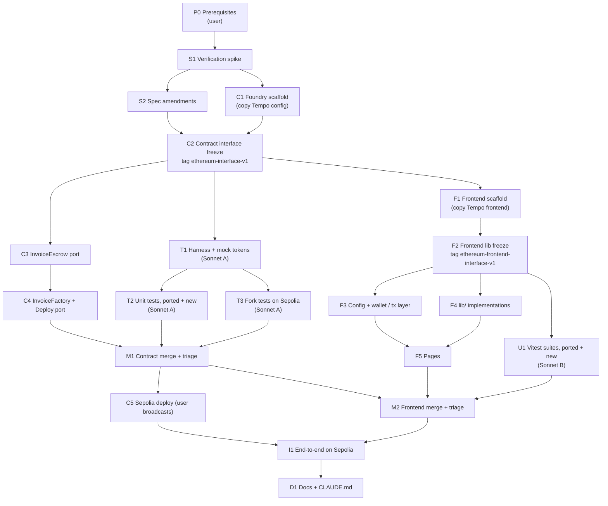

# InvoiceDiscount on Ethereum: Implementation Plan (DAG)

> Source spec: [`../spec/invoice-discount-spec.md`](../spec/invoice-discount-spec.md) ("the spec"). Written 2026-10-30. The Tempo implementation this ports from is in [`../../../tempo/`](../../../tempo/); its plan, [`tempo/docs/plan/implementation-dag.md`](../../../tempo/docs/plan/implementation-dag.md), uses the same lane structure.

## Decisions made while planning

| Topic | Decision |
|---|---|
| Reuse | **Port, don't rewrite.** Contracts, deploy script, frontend and tests all start as copies of the Tempo files and are changed only where the spec's §2 table says Ethereum differs. Nothing is imported across chains (root `CLAUDE.md`: chains share nothing) |
| DAG shape | Five lanes. **Contracts** (main session, Opus), **contract tests** (Sonnet sub-agent A), **frontend** (Opus sub-agent), **frontend tests** (Sonnet sub-agent B), and a **join/integration** lane (main session + user). Each sub-agent runs in its own git worktree |
| Who writes tests | **All tests are written by Sonnet sub-agents**, black-box: Foundry unit and fork tests (agent A) and frontend Vitest tests (agent B). The implementers (main session, frontend agent) write no tests. The Tempo plan's main-session smoke-test node is dropped |
| What the test agents see | Interfaces only. For the contracts: the Ethereum spec, the Tempo specs it references, and the frozen Ethereum stubs. For the frontend: the frozen `src/lib/` signatures (stub bodies). Both agents also **port the existing Tempo test files**, which were themselves written black-box. They must not read `tempo/contracts/src/`, `tempo/frontend/src/` (except `*.test.ts`), or any Ethereum implementation |
| Interface tags | `ethereum-interface-v1` (contracts) and `ethereum-frontend-interface-v1` (frontend `src/lib/`). The test lanes branch from these. A change after a tag needs the user's approval and a new tag (`-v2`), merged into every branch |
| Ops | **The user runs** keystore creation, faucets and the Sepolia broadcast. Claude writes the code, scripts and exact commands |
| Package manager | pnpm via corepack, as on Tempo (the WSL `npm` is the Windows binary) |
| Tokens | **PYUSD, USDG and USDC only**, enforced by the frontend's token list. No on-chain allowlist (spec §9); the contract accepts any token with code |
| Contract verification | **Sourcify** (`--verify --verifier sourcify`), so no Etherscan API key |

## Isolation, honestly stated

- **From the Ethereum implementation: enforced by branch.** Each test lane's worktree branches from an interface tag where every body is a stub. The real Ethereum code doesn't exist on its branch.
- **From the Tempo implementation: enforced by instruction only.** `tempo/` is on `main`, so it is in every worktree. The test briefs forbid reading `tempo/contracts/src/` and non-test files under `tempo/frontend/src/`. The ported code is nearly identical to Tempo's, so a test agent reading it would undo the point of black-box testing.
- The main session and the frontend agent don't read the test lanes' files before the merge nodes (M1, M2). Neither side edits the other's files at any point; fixes go back to the file's owner.

---

## The DAG

### Lanes and critical path

| Lane | Who | Nodes | Starts after |
|---|---|---|---|
| Setup | main session + user | P0 → S1 → S2 | — |
| Contracts | main session (Opus) | C1 → C2 → C3 → C4 | S1 (C1), S2 (C2) |
| Contract tests | Sonnet sub-agent A, worktree from `ethereum-interface-v1` | T1 → {T2, T3} | C2 |
| Frontend | Opus sub-agent, worktree from `ethereum-interface-v1` | F1 → F2 → {F3, F4} → F5 | C2 (needs the frozen ABI) |
| Frontend tests | Sonnet sub-agent B, worktree from `ethereum-frontend-interface-v1` | U1 | F2 |
| Join | main session (+ user for C5, I1) | M1 → C5; M2; I1 → D1 | see DAG |

After C2, four agents work at once: C3/C4, T1–T3, F1–F5, and (from F2) U1.

**Critical path:** P0 → S1 → S2 → C2 → F1 → F2 → F3/F4 → F5 → M2 → I1 → D1. The frontend lane is the longest, so F1 starts the moment C2 is tagged. C5 (deploy) is off the critical path as long as M1 finishes before M2.

M2 depends on M1 only so that the frontend's ABI is regenerated from the final, merged contracts (`corepack pnpm sync-abi`).

---

## Reuse map

What each Ethereum file starts from. "Copy" means the file is copied and edited in place; it is never imported from `tempo/`.

| Ethereum file | Starts from (Tempo) | Changes |
|---|---|---|
| `contracts/foundry.toml` | `tempo/contracts/foundry.toml` | Drop `network = "tempo"`; `sepolia` RPC alias; same `fork` profile |
| `contracts/src/InvoiceEscrow.sol` | `tempo/contracts/src/InvoiceEscrow.sol` @ `tempo-interface-v2` | `ITIP20`/`StdPrecompiles` → `IERC20` + `SafeERC20`; `NotTIP20` → `InvalidToken` (code-size check); memo transfers → `safeTransfer`/`safeTransferFrom`; `invoiceRef` added to the four events; NatSpec updated |
| `contracts/src/InvoiceFactory.sol` | `tempo/contracts/src/InvoiceFactory.sol` | Imports only |
| `contracts/script/Deploy.s.sol` | `tempo/contracts/script/Deploy.s.sol` | Comment (`$SEPOLIA_RPC_URL`) |
| `contracts/test/unit/Base.t.sol` | `tempo/contracts/test/unit/Base.t.sol` | Real TIP-20 → `MockERC20`; extra mock tokens (T1) |
| `contracts/test/unit/*.t.sol` | the four Tempo unit files | Memo assertions → `invoiceRef` event assertions; `NotTIP20` → `InvalidToken`; new spec §6 tests |
| `contracts/test/fork/InvoiceFork.t.sol` | `tempo/contracts/test/fork/InvoiceFork.t.sol` | AlphaUSD/OUSD → Sepolia PYUSD/USDC |
| `frontend/` (whole tree) | `tempo/frontend/` minus `node_modules`, `dist`, `.env`, `src/abi/*` | See F1–F5 |
| `frontend/src/lib/{units,ref,validation,split,status,historyCache,invoice}.ts` | same files | None: bodies restored verbatim in F4 |
| `frontend/src/lib/actions.ts` | same file | Drop `walletMode`, `mppEnabled`, `payNow` |
| `frontend/src/lib/history.ts` | same file | `TransferWithMemo` → ERC-20 `Transfer`; events carry `invoiceRef` |
| `frontend/src/lib/logs.ts` | same file | `LOG_PAGE_SIZE` from S1 |
| `frontend/src/lib/{fundPath,cutoff,errors}.ts` | new | Spec §5.2, §5.3 |
| `frontend/src/lib/mpp.ts`, `hooks/useMppPay.ts` | — | Not copied |
| `frontend/src/**/*.test.ts` | the Tempo test files | Ported by Sonnet B in U1, not by the frontend agent |

---

## Nodes

### P0 — Prerequisites (user runs)

- Foundry (plain `foundryup`; the Tempo build also runs standard EVM) and Node ≥ 20, both already installed.
- A Sepolia RPC URL that accepts a 10,000-block `eth_getLogs` range (`https://ethereum-sepolia.publicnode.com` works; not Alchemy free tier). Verification uses Sourcify, so no Etherscan API key.
- Deployer keystore: `cast wallet import sepolia-deployer --interactive`, funded with Sepolia ETH.
- Two MetaMask accounts on Sepolia (seller, buyer), each with Sepolia ETH; the buyer also with PYUSD and USDC from their faucets.

**Verify:** `cast balance <deployer> --rpc-url $SEPOLIA_RPC_URL` is non-zero; the buyer's PYUSD and USDC `balanceOf` are non-zero.

### S1 — Verification spike (main session)

> **Status:** ✅ **Completed** 2026-10-30. See [`verification-notes.md`](../spec/verification-notes.md). Live MetaMask capabilities still to see in F3/I1.

Resolve spec §8:
1. PYUSD and USDC addresses and decimals on Sepolia; USDG on Sepolia (address, faucet) or drop it. Cross-check with Mesh's Sepolia token list if it's reachable.
2. PYUSD and USDC: no transfer fee, zero-amount transfers succeed, pause/freeze functions as described in spec §3.9 (read the verified sources on Etherscan).
3. Chosen RPC provider's `eth_getLogs` block-range and result caps → `LOG_PAGE_SIZE`.
4. EIP-5792 on MetaMask/Sepolia: what `wallet_getCapabilities` reports for an EOA, and whether `wallet_sendCalls` with `forceAtomic: true` works. Confirm wagmi's `useCapabilities`, `useSendCalls` and `useWaitForCallsStatus` names and options in the installed wagmi version (Tempo uses wagmi 3.7).
5. `deal` on forked PYUSD and USDC proxies.
6. OpenZeppelin version and the exact `SafeERC20` error (`SafeERC20FailedOperation(address)` in v5).

**Output:** `ethereum/docs/spec/verification-notes.md`, one line per item: confirmed / differs (with the right value) / unknown (with a fallback). This is an input to both test agents.
**Verify:** every item is resolved or has a fallback.

### S2 — Spec amendments

> **Status:** ✅ **Completed** 2026-10-30. Diff approved by the user: USDG added, `LOG_PAGE_SIZE = 10_000n`, §3.9 and §8 updated; Sourcify instead of Etherscan verification.

Apply S1's corrections to the spec (token table, any API name changes, `LOG_PAGE_SIZE`). Show the user the diff before saving.

**Verify:** spec §8 items each link to `verification-notes.md`; nothing in the spec says "to confirm" without a fallback.

### C1 — Foundry scaffold (main session)

> **Status:** ✅ **Completed** 2026-10-30. `forge-std` v1.17.0 and OpenZeppelin 5.7.0 as submodules at Tempo's pinned commits; no `test/smoke/` (smoke tests dropped, see Decisions).

- `ethereum/contracts/`: `forge init --no-git`, then copy `foundry.toml` from Tempo and drop `network = "tempo"`. Keep `solc`, the optimizer and the `fork` profile; `[rpc_endpoints] sepolia = "${SEPOLIA_RPC_URL}"`.
- `forge install OpenZeppelin/openzeppelin-contracts` (version from S1) and `forge-std`. No `tempo-std`.
- Directories `test/unit/`, `test/fork/`, `test/mocks/`. `.env.example` with `SEPOLIA_RPC_URL=`.

**Verify:** `forge build` passes on the empty project.

### C2 — Contract interface freeze (main session)

> **Status:** ✅ **Completed** 2026-10-30, tag `ethereum-interface-v1`. Storage layout matches spec §3.3 (slot 0 packed, tiers at slot 7). Frozen ABIs saved in `contracts/abi/`. ABI diff against Tempo: `NotTIP20` → `InvalidToken`, and `bytes32 indexed invoiceRef` added to `Funded`, `Paid`, `Cancelled`, `SettledDirect`; nothing else. Note: OpenZeppelin library errors appear in the ABI only once a body uses the library, so after C3/C4 the escrow ABI also lists `SafeERC20FailedOperation(address)` and the factory ABI `FailedDeployment()` and `InsufficientBalance(uint256,uint256)` (as Tempo's factory ABI does). Those are the only allowed ABI differences from the tag.

- Copy `tempo/contracts/src/InvoiceEscrow.sol` and `InvoiceFactory.sol` (tag `tempo-interface-v2`), then apply the signature-level changes from the reuse map: imports, `InvalidToken`, the four events with `bytes32 indexed invoiceRef`.
- **Replace every function body with a stub** (`revert("unimplemented")`, or a zero value for views). The factory constructor still deploys the implementation.
- Rewrite the NatSpec so it describes the Ethereum behaviour (spec §3.5): check order and the error for each check, effects, the `SafeERC20` calls, events. This is the test agent's contract.
- Commit, tag `ethereum-interface-v1`. **Then launch Sonnet agent A and the frontend agent** (briefs below).

**Verify:** `forge build`; `forge inspect InvoiceEscrow storageLayout` matches spec §3.3; every external function's NatSpec names its revert errors; the ABI diff against Tempo's `tempo-interface-v2` shows only the changes in the reuse map (save `forge inspect … abi --json` for both and diff them).

### C3 — InvoiceEscrow port (main session, in parallel with T1–T3)

> **Status:** ✅ **Completed** 2026-10-30. `forge build` passes; ABI equals the tag plus `SafeERC20FailedOperation(address)` (allowed, see C2).

- Restore the function bodies from `tempo/contracts/src/InvoiceEscrow.sol`, then apply the spec's Ethereum changes: the `token.code.length` check, `SafeERC20` calls in place of the memo transfers, `invoiceRef` in each `emit`.
- Keep the Tempo order of effects and interactions. In `fund`, `status = Funded` comes before `safeTransferFrom` (spec §3.5).

**Verify:** `forge build`; the ABI is identical to `ethereum-interface-v1`. (No tests in this lane; they arrive at M1.)

### C4 — InvoiceFactory + Deploy port (main session)

> **Status:** ✅ **Completed** 2026-10-30. ABI equals the tag plus `FailedDeployment()` and `InsufficientBalance(uint256,uint256)` (allowed, see C2); `forge script script/Deploy.s.sol` (no broadcast) logs both addresses.

- `InvoiceFactory.sol`: restore the Tempo body (`Clones.clone` → `initialize` → emit → return).
- `script/Deploy.s.sol`: copy from Tempo; update the comment to `$SEPOLIA_RPC_URL`.

**Verify:** `forge build`; ABI unchanged from the tag; `forge script script/Deploy.s.sol` runs locally (no broadcast) and logs both addresses.

### T1 — Harness + mock tokens (Sonnet agent A)

> **Status:** ✅ **Completed** 2026-10-30, branch `ethereum-contract-tests` (`162d737`). Mocks plus 6 harness self-tests.

- Port `tempo/contracts/test/unit/Base.t.sol`. Replace the TIP-20 setup with `test/mocks/MockERC20.sol` (OpenZeppelin `ERC20`, 6 decimals, public `mint`). Keep the named actors and helpers.
- New mocks in `test/mocks/` for the spec §6 cases: `NoReturnToken` (USDT-style, no return value), `FalseReturnToken` (returns `false`), `ReentrantToken` (calls back into the escrow during `transfer`), and an `18`-decimal `MockERC20` for amount tests.

**Verify:** `forge build`; a harness self-test mints and transfers each mock.

### T2 — Unit tests, ported + new (Sonnet agent A)

> **Status:** ✅ **Completed** 2026-10-30. 154 unit tests (133 ported, 15 new, 6 harness); 148 red against the stubs, the 6 harness tests justified in `test/SPEC_QUESTIONS.md`. 3 new spec questions.

- Port `InvoiceEscrow.t.sol`, `InvoiceEscrowEdge.t.sol`, `InvoiceEscrowSettleDirect.t.sol` and `InvoiceFactory.t.sol`:
  - `TransferWithMemo` assertions → `vm.expectEmit` on the escrow event with `invoiceRef`, plus the ERC-20 `Transfer` event for amounts and recipients.
  - `NotTIP20` cases → `InvalidToken` (EOA, `address(0)`).
- Add the spec §6 tests: `test_EventsCarryInvoiceRef`, `test_NoReturnValueToken`, `test_FalseReturnValueToken`, `test_ReentrantTokenCannotDoubleSpend`.
- Carry over the Tempo `SPEC_QUESTIONS.md` resolutions; record new ambiguities in `test/SPEC_QUESTIONS.md`.

**Verify:** red check: `forge test --match-path 'test/unit/*'` against the stubs fails **every** test. Every `expectRevert` names an exact selector. Committed on the test branch.

### T3 — Fork tests on Sepolia (Sonnet agent A)

> **Status:** ✅ **Completed** 2026-10-30. 11 fork tests, all red against the stubs; `deal` used for funding.

- Port `tempo/contracts/test/fork/InvoiceFork.t.sol` to Sepolia: `test_Fork_PyusdLifecycle`, `test_Fork_UsdcLifecycle` (create, fund, pay with a discount, cancel), `InvalidToken` against an EOA, and the `createInvoice` gas snapshot with 0, 3 and 10 tiers.
- Fund actors with `deal`, or a holder `prank` if S1 item 5 says `deal` fails.

**Verify:** compiles; red against the stubs under `SEPOLIA_RPC_URL=… FOUNDRY_PROFILE=fork forge test`; plain `forge test` skips `test/fork/`.

### M1 — Contract merge + triage (main session; user decides spec gaps)

> **Status:** 🔶 **In progress.** Merged (`28246ae`): 154 unit and 11 fork tests pass, 100% coverage of `src/`, 0 impl bugs, 0 test bugs. Waiting on the user's decision on 3 spec gaps; see [`test-lane-findings.md`](test-lane-findings.md).

As Tempo M1:
1. Merge the test branch into the contract branch.
2. Run `forge test` and the fork suite.
3. Classify each failure and each `SPEC_QUESTIONS.md` entry as **impl bug** (main session fixes `src/`), **test bug** (back to agent A via SendMessage), or **spec gap** (the user decides; the spec is amended, then the wrong side fixes its code). Log each in `ethereum/docs/plan/test-lane-findings.md`.
4. Repeat until green. Run `forge coverage`; uncovered lines go back to agent A.

**Verify:** unit and fork suites pass; 100% line coverage of `src/`; the findings log has a summary, including how many findings came from the ported tests versus the new ERC-20 tests.

### C5 — Sepolia deploy (user broadcasts)

- Claude gives the exact command (spec §7): `forge script script/Deploy.s.sol --rpc-url $SEPOLIA_RPC_URL --account sepolia-deployer --broadcast --verify --verifier sourcify` (no API key).
- Write `ethereum/contracts/deployments/sepolia.json` with `{ factory, implementation, deployBlock }`.

**Verify:** both contracts verified on Sourcify (and shown as verified on Sepolia Etherscan); `cast call <factory> "implementation()(address)"` returns the implementation.

### F1 — Frontend scaffold (frontend agent)

> **Status:** ✅ **Completed** 2026-10-30 on branch `ethereum-frontend`. `pnpm install` (wagmi 3.7.7, viem 2.57.7) and `sync-abi` pass.

- Copy `tempo/frontend/` to `ethereum/frontend/`, without `node_modules`, `dist`, `.env`, `src/abi/*`, and **without any `*.test.ts`** (those belong to agent B).
- Don't copy `lib/mpp.ts` and `hooks/useMppPay.ts`. Remove `accounts` and `mppx` from `package.json`; rename the package `invoice-discount-ethereum`.
- `scripts/sync-abi.mjs`: one output directory (`src/abi/`), no mpp-server.
- `corepack pnpm install`, `corepack pnpm sync-abi` against the C2 stubs.

**Verify:** `corepack pnpm install` and `sync-abi` succeed. The build doesn't have to pass yet.

### F2 — Frontend lib freeze (frontend agent)

> **Status:** ✅ **Completed** 2026-10-30, tag `ethereum-frontend-interface-v1` (`b9114d2`). `src/lib/` + `config.ts` type-check (with `noUnusedParameters` off for the stubs); every export has TSDoc. Agent decisions: `upcomingCutoff` is strict at both ends (`now < cutoff`, `cutoff - now < window`); `friendlyError` detects viem `InsufficientFundsError` in the cause chain or `/insufficient funds/i`; history `created` entry has no `invoiceRef`; `config.ts` adds `RPC_URL` and `ETH_FAUCET_URL`.

The frontend's black-box boundary is `src/lib/`. These are the pure modules the Tempo Vitest suites test; hooks and pages aren't unit-tested, as on Tempo.
- For **every** file in `src/lib/`: final exported types, constants and function signatures, TSDoc on each export (inputs, outputs, edge cases), and bodies that `throw new Error('unimplemented')`. That includes the unchanged files, so agent B sees no implementation at all.
- Signature changes (reuse map): `actions.ts`, `history.ts`, `logs.ts`, and three new modules:
  - `fundPath.ts`: `fundPath(atomicStatus: 'supported' | 'ready' | 'unsupported' | undefined): 'batch' | 'sequential'` (spec §5.2).
  - `cutoff.ts`: `upcomingCutoff(tiers, now, windowSeconds = 300n): bigint | undefined`, the next cutoff within the window (spec §5.3 warning).
  - `errors.ts`: `friendlyError(error: unknown): string`, which maps insufficient-gas errors to "You need Sepolia ETH to pay gas" and passes other messages through (spec §5.2).
- `config.ts` is data, not logic: write it in full (Sepolia chain, injected connector, token list from S1, `EXPLORER_URL`, env vars).
- Commit, tag `ethereum-frontend-interface-v1`. **Then launch Sonnet agent B.**

**Verify:** `src/lib/` and `config.ts` type-check (`tsc --noEmit` scoped to those files; pages and hooks may still reference removed Tempo APIs until F3/F5); every export has TSDoc.

### F3 — Config + wallet / tx layer (frontend agent)

- Delete `useWalletMode.ts`. `useInvoiceWrite`: `writeContract` + `waitForTransactionReceipt`, with no `feePayer` or `*Sync` actions; exposes pending, tx hash, success and error (via `friendlyError`).
- `useFund`: `useCapabilities` → `fundPath`. `batch` → `useSendCalls` with `[approve, fund]` and `forceAtomic: true`, waited with `useWaitForCallsStatus`. `sequential` → `approve`, wait, `fund`.
- `ConnectButton`: injected only; "Switch to Sepolia" when on another chain; Sepolia ETH note with faucet link.

**Verify:** `tsc --noEmit` on `hooks/` and `components/`; in `corepack pnpm dev`, MetaMask connects, switches chain and disconnects.

### F4 — lib/ implementations (frontend agent, in parallel with F3)

- Restore the bodies of the unchanged modules verbatim from `tempo/frontend/src/lib/`.
- Port `actions.ts`, `history.ts` and `logs.ts` per the reuse map. Implement `fundPath`, `upcomingCutoff` and `friendlyError` to their TSDoc.

**Verify:** `tsc --noEmit`; exports identical to `ethereum-frontend-interface-v1` (diff of the `.d.ts` output from `tsc --declaration --emitDeclarationOnly`).

### F5 — Pages (frontend agent)

Port `Home`, `CreateInvoice` and `InvoiceDetail` per spec §5.3:
- Home: single connect button, ETH note.
- CreateInvoice: Sepolia token list; amounts from `decimals()`.
- InvoiceDetail: remove Pay now via MPP and the MPP exchange panel; the cutoff warning from `upcomingCutoff`; tx hash with an Etherscan link as soon as it's known; history with `SettledDirect` and inbound ERC-20 transfers.

**Verify:** `corepack pnpm build` and `lint` pass. Browser checks happen in I1.

### U1 — Vitest suites, ported + new (Sonnet agent B)

- Port `lib.test.ts`, `logs.test.ts`, `history.test.ts`, `historyCache.test.ts`, `actions.test.ts` and `config.test.ts` from `tempo/frontend/src/` to the frozen signatures. Drop the MPP cases; history fixtures use ERC-20 `Transfer` and `invoiceRef`.
- New tests: `fundPath` for every capability status; `upcomingCutoff` (no tiers, cutoff inside/outside/exactly at the window edge, past cutoffs); `friendlyError` for viem's insufficient-funds error and a pass-through; `toUnits`/`fromUnits` at 18 decimals; `visibleActions` for every role × status × before/after due date × clone balance.
- Ambiguities go in `frontend/SPEC_QUESTIONS.md`.

**Verify:** red check: `corepack pnpm test` against the stubs fails every test except `config.test.ts`, which tests data that F2 wrote in full (justified in `SPEC_QUESTIONS.md`). Committed on the test branch.

### M2 — Frontend merge + triage (main session)

1. Merge the frontend branch and the frontend test branch; run `corepack pnpm sync-abi` against the M1 contracts.
2. `corepack pnpm test`, `build`, `lint`.
3. Triage as M1 (impl bug → frontend agent; test bug → agent B; spec gap → user), logged in the same `test-lane-findings.md`.

**Verify:** test, build and lint all pass; the findings log has a frontend section.

### I1 — End-to-end on Sepolia (main session + user)

`ethereum/docs/e2e-checklist.md`, ported from `tempo/docs/e2e-checklist.md`. Use tier cutoffs **minutes** apart. `.env` gets the C5 addresses.
1. Seller creates a PYUSD invoice with a payout address. A duplicate reference is blocked.
2. Buyer funds with a refund address, on the batched path if S1 found a wallet that supports it, and on the two-transaction path.
3. Trigger in tier 1, then on a second invoice after the cutoff. Check both splits against `activeDiscount` and the Etherscan transfers.
4. Seller cancels unfunded and funded invoices; buyer cancel is blocked before the due date and allowed after.
5. Direct settlement: send `due` PYUSD straight to an Active invoice, then Finish settlement. Send less to another, then Accept and settle as the seller.
6. Repeat one paid invoice in USDC.
7. History shows every step, with `invoiceRef` on each escrow event in Etherscan's logs tab.

**Verify:** every item ticked, with tx hashes recorded.

### D1 — Docs

- Root `CLAUDE.md`: an Ethereum section with the build, test, fork, deploy and frontend commands, matching the Tempo section's format.
- Spec status → implemented; link the findings summary.
- Mesh spec §3: point to this port's spec instead of "This spec doesn't cover the port itself".

**Verify:** a fresh clone can follow the commands to `forge test` and `corepack pnpm dev`.

---

## Sub-agent briefs

### Sonnet agent A: contract tests (launched at C2)

Agent tool: `model: "sonnet"`, `isolation: "worktree"`, branched from `ethereum-interface-v1`.

> You are writing the Foundry test suite for InvoiceDiscount on Ethereum, adversarially. Another model is implementing the contracts and you will not see its code.
> **Read:** `ethereum/docs/spec/invoice-discount-spec.md`, `ethereum/docs/spec/verification-notes.md`, the Tempo specs it references (`tempo/docs/spec/invoice-discount-spec.md`, `tempo/docs/spec/mpp-pay-now-spec.md`), the frozen stubs in `ethereum/contracts/src/`, and this plan's T1–T3 nodes.
> **Port:** the Tempo tests in `tempo/contracts/test/` (unit and fork), plus `tempo/contracts/test/SPEC_QUESTIONS.md` and `tempo/docs/plan/test-lane-findings.md` for questions already resolved. They were written black-box against the same behaviour; adapt them to ERC-20 as the spec's §2 and §6 describe.
> **Do not read** `tempo/contracts/src/` or any implementation of these contracts. The spec and the NatSpec are the source of truth. Where they disagree or are ambiguous, don't guess: record it in `ethereum/contracts/test/SPEC_QUESTIONS.md`, test the reading you think is right, and mark it `// SPEC-QUESTION n`.
> Test through the external interface only. Every `expectRevert` names an exact error selector.
> **Done when** `forge build` passes and `forge test --match-path 'test/unit/*'` against the stubs fails every test (justify any exception in `SPEC_QUESTIONS.md`). Commit on your branch and report the test count, how many tests were ported versus new, and the spec questions.

### Frontend agent (Opus, launched at C2)

Agent tool: `isolation: "worktree"`, branched from `ethereum-interface-v1`.

> Build `ethereum/frontend/` by porting `tempo/frontend/`, following nodes F1–F5 of `ethereum/docs/plan/implementation-dag.md` and spec §5. Reuse the Tempo code wherever the spec doesn't call for a change. Write no tests: a separate agent writes them against the `src/lib/` signatures you freeze in F2. Don't copy any `*.test.ts`. After F2, commit and tag `ethereum-frontend-interface-v1` and report back, so the test agent can start. Don't change a frozen export without asking. Use `corepack pnpm`, not `npm`. Report when F5's build and lint pass.

### Sonnet agent B: frontend tests (launched at F2)

Agent tool: `model: "sonnet"`, `isolation: "worktree"`, branched from `ethereum-frontend-interface-v1`.

> You are writing the Vitest suite for the InvoiceDiscount Ethereum frontend, adversarially, against the frozen `ethereum/frontend/src/lib/` signatures (their bodies are stubs). **Read:** spec §5 (`ethereum/docs/spec/invoice-discount-spec.md`), `ethereum/docs/spec/verification-notes.md`, the TSDoc in `src/lib/` and `src/config.ts`, and node U1 of the plan. **Port:** the Tempo test files `tempo/frontend/src/**/*.test.ts`. **Do not read** non-test files under `tempo/frontend/src/`. Ambiguities go in `ethereum/frontend/SPEC_QUESTIONS.md`. **Done when** `corepack pnpm test` against the stubs fails every test except `config.test.ts`. Commit and report the test count and questions.

---

## Open risks

| Risk | Affects | Mitigation |
|---|---|---|
| A test agent reads the Tempo implementation | the black-box guarantee | The brief forbids it. The test reports list the files read; M1/M2 check that list |
| Ported tests pass against stubs (vacuous) | T2, U1 | Every stub reverts or throws; exact selectors on `expectRevert`; red check before commit |
| MetaMask reports no atomic batching on Sepolia | F3, I1 step 2 | The two-transaction path is the fallback and is always tested; the batch path is tested only if S1 finds a wallet that supports it |
| The RPC provider's `eth_getLogs` cap is tight (e.g. a few hundred blocks) | F4, duplicate check, history | S1 measures it; the deploy block keeps the scan short; pick a provider with a wider range if needed |
| PYUSD/USDC Sepolia faucets are rate-limited | I1 | P0 gets balances early; tests use small amounts |
| `deal` fails on a proxied Sepolia token | T3 | Holder `prank` + `transfer`, as on Tempo |
| A frozen interface is wrong | all lanes | Change rule: user approval, new tag, merged into every branch |
