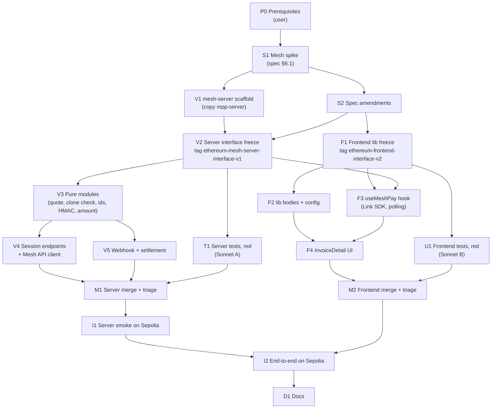
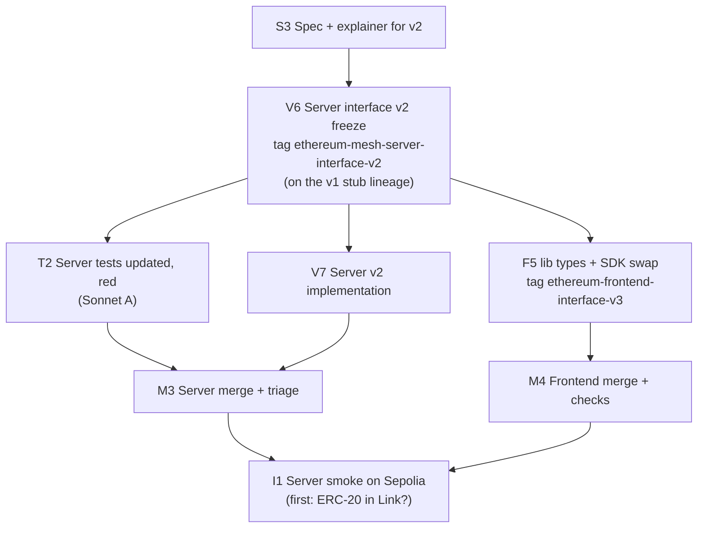

# Pay Now via Mesh: Implementation Plan (DAG)

> Source spec: [`../spec/mesh-pay-now-spec.md`](../spec/mesh-pay-now-spec.md) (the "Mesh spec"). Builds on the port plan [`implementation-dag.md`](implementation-dag.md) and reuses the shape of Tempo's [`mpp-pay-now-dag.md`](../../../tempo/docs/plan/mpp-pay-now-dag.md). Written 2026-11-03.

## Decisions made while planning

| Topic | Decision |
|---|---|
| Contracts | **No change**, no new contract tag, no redeploy (Mesh spec §3). No contract lane |
| Who writes tests | **All tests are written by Sonnet 5.5 sub-agents**, black-box, after the interfaces are frozen: agent A for mesh-server, agent B for the frontend. The implementers write no tests (as in the port plan) |
| What the test agents see | Interfaces only: frozen stubs with TSDoc at an interface tag, the specs, the explainer, this plan, and the Tempo **test** files they port. Isolation from the new code is enforced by branch (the test worktree branches from a tag where the bodies are stubs). Isolation from `tempo/mpp-server/src/` (non-test files) is by instruction only, as before (user-confirmed); the agents' reports list the files they read, and the merge nodes check that list |
| Interface tags | **`ethereum-mesh-server-interface-v1`** (new: `mesh-server/src/`) and **`ethereum-frontend-interface-v2`** (Mesh spec §3: `src/lib/` changes). A change after a tag needs the user's approval and a new tag, merged into every branch |
| Mesh access | Planned: S1 first, gating the code lanes. **Changed 2026-11-03 (user decision):** the dashboard's keys don't authenticate (S1 status below), so S2 and the code lanes proceed on the docs fallbacks in spec §6.1, and S1 runs once Mesh answers, before I1 |
| Quote window | **900 s**: the Link Token's 10 minutes plus 5 minutes for the transfer to land and `settleDirect()` to be included (user-confirmed). A later arrival is the §7 late-arrival risk |
| Payer details for other viewers | New endpoint **`GET /invoices/:address/mesh-sessions`** lists the invoice's sessions, so the seller also sees "Paid via Mesh" (user-confirmed; spec amendment in S2) |
| Receipt wait | On `Succeeded`, wait **up to 180 s** (15 Sepolia blocks) for the `TxHash` receipt. Found or not, then read the clone's balance: the chain is the truth, so a balance that covers the amount due settles even if the reported hash can't be found. Spec amendment in S2 |
| Testable seams | The server takes its chain reads from a viem client (faked in tests with a `custom` transport, as `mpp-server`), its Mesh API calls from an injected `fetch`, and `settleDirect()` from an injected `settle(invoice)` function. `index.ts` builds the real ones. These three are the only seams; no DI framework |
| Background work | The webhook route answers `200` and calls `processEvent(event)` without awaiting it. `processEvent` is exported and returns a promise, so tests await it directly |
| Session ids | `id` = 16 random hex chars. `transactionId` = `<invoice, lowercase>-<id>` (59 chars), decoded back to the invoice after a restart. `userId` = `buyer-<id>`, random per session (no personal data, nothing to correlate). S1 confirms Mesh's length and character limits |
| Settler key | A **throwaway testnet key** in `mesh-server/.env` (gitignored), generated with `cast wallet new` and funded with Sepolia ETH by the user, as `mpp-server`. It has no rights in the contract |
| Tunnel | **ngrok** with its free static domain. Mesh allows one sandbox webhook URL, so a URL that survives restarts avoids re-registering it in the dashboard. Fallback: `cloudflared` quick tunnel, re-registered on each restart |
| Port | mesh-server listens on **8788**, so it can run next to `mpp-server` (8787) |
| Ops | **The user runs** the Mesh dashboard setup, the tunnel, key generation and funding. Claude writes the code, scripts and exact commands |
| Package manager | pnpm via corepack (the WSL `npm` is the Windows binary) |

Not done, on purpose: checking the webhook sender's IP (`20.22.113.37`; the explainer calls it optional and the HMAC already authenticates), polling Mesh's transfer list as a webhook backup, and persisting sessions (Mesh spec §8).

---

## The DAG



### Lanes and critical path

| Lane | Who | Nodes | Starts after |
|---|---|---|---|
| Setup | main session + user | P0 → S1 → S2 | — |
| Server | main session (Opus) | V1 → V2 → V3 → {V4 ‖ V5} | S1 (V1); S2 (V2) |
| Server tests | Sonnet agent A, worktree from `ethereum-mesh-server-interface-v1` | T1 | V2 tag |
| Frontend | Opus frontend agent, worktree from `main` after S2 | F1 → {F2 ‖ F3} → F4 | S2 (F1); V2 (F3, for the response types) |
| Frontend tests | Sonnet agent B, worktree from `ethereum-frontend-interface-v2` | U1 | F1 tag |
| Join | main session (+ user for I1, I2) | M1, M2 → I1 → I2 → D1 | see DAG |

After the two tags, four agents work at once: V3–V5 (main session), T1 (A), F2–F4 (frontend agent), U1 (B).

**Critical path:** P0 → S1 → S2 → V2 → V3 → V5 → M1 → I1 → I2 → D1. The webhook path (V5) is the largest piece of new code. The frontend lane is short (one flag, one hook, one page section) and should finish well before M1.

---

## What depends on the spike (S1)

| Mesh spec §6.1 item | Expected | If it differs | Affects |
|---|---|---|---|
| 1. Mesh's PYUSD/USDG contracts on Sepolia (verification notes 1d) | The port's addresses | Change the token lists (data only, frontend `config.ts` and `MESH_TOKENS`); invoices on the old contracts can't use Mesh | V2, F1 |
| 2. Mesh `networkId` for Sepolia and the `symbol` strings for `toAddresses` | A UUID; `PYUSD`, `USDG` | — (values only) | V2 (`.env.example`) |
| 3. `Chain` and `Token` strings on a Sepolia webhook | e.g. `"Sepolia"` / `"PYUSD"` | — (values only) | V5 |
| 4. `POST /api/v1/linktoken` response shape | `{ content: { linkToken } }` | Use the actual path | V4 |
| 5. `transactionId` and `userId` limits | ≥ 59 chars, `-` and hex allowed | Shorten: drop the `0x`, or hash the address and keep a lookup (then a restart loses the mapping; record that) | V2 |
| 6. `X-Mesh-Signature-256` format | Base64 HMAC-SHA256 of the raw body, no prefix | Match the actual format (e.g. a `sha256=` prefix, hex) | V3 |
| 7. `@meshconnect/web-link-sdk` version and callback payloads | `createLink({ onTransferFinished, onExit })`, `openLink(token)` | Use the installed names | F3 |

---

## Nodes

### P0 — Prerequisites (user runs)

- Mesh dashboard (sandbox): an API key with Read & Write, **Allowed domains** includes `http://localhost:5173`.
- Tunnel: `ngrok http 8788 --domain=<your-static-domain>`. Register `https://<domain>/webhooks/mesh` as the sandbox webhook URL and keep the signing secret (shown once). **v2:** register it under **Account > Webhooks** in the sandbox, subscribed to `transfer.status_updated`.
- Settler key: `cast wallet new`; fund the address with Sepolia ETH (a faucet; ~0.05 ETH is plenty).
- The port's buyer MetaMask account on Sepolia with PYUSD and some ETH (from the port's P0).

**Verify:** `cast balance <settler> --rpc-url https://ethereum-sepolia.publicnode.com` is non-zero; the tunnel's URL answers (502 is fine before the server exists).

### S1 — Mesh spike (main session)

> **Status:** ✅ **Completed** 2026-11-03 with the Mesh developer MCP server (the docs this plan first followed describe Mesh's **legacy** API). Auth (OAuth client credentials), session creation on `eip155:11155111` for PYUSD/USDG/USDC/ETH, and the health check probed live; webhook, signature and SDK formats from the v2 docs and OpenAPI schema. Results: [`verification-notes.md` → Mesh pay-now spike](../spec/verification-notes.md#mesh-pay-now-spike-s1-of-planmesh-pay-now-dagmd). The changes go through the [v2 sub-DAG](#mesh-pay-v2-change-after-s1). Open: whether Link offers an ERC-20 wallet transfer on Sepolia (first step of I1).

Resolve the items in [What depends on the spike](#what-depends-on-the-spike-s1) with throwaway scripts in the scratchpad (not checked in), using the user's sandbox keys from a local `.env` in the scratchpad:

1. `GET /api/v1/transfers/managed/networks` and `…/tokens`: Sepolia's `networkId`; the PYUSD and USDG contract addresses and symbols (items 1, 2).
2. `POST /api/v1/linktoken` with the Mesh spec §4.3 body against an existing Active PYUSD clone, with a 59-char `transactionId` (items 4, 5).
3. A scratch Vite page on `localhost:5173` with the pinned SDK: open Link with that token, run a **sandbox Coinbase** payment (no real assets move), and log the callback payloads (item 7).
4. A scratch Hono receiver behind the tunnel logs the raw body and headers of the webhook from step 3, and checks the HMAC against the raw body (items 3, 6).

**Output:** a "Mesh pay-now spike" section in [`../spec/verification-notes.md`](../spec/verification-notes.md), one row per item (confirmed / differs / unknown with a fallback), with the SDK version. Item 1d in the existing table points to it.
**Verify:** every item is resolved or has a fallback.

### S2 — Spec amendments (main session, user approves)

> **Status:** ✅ **Approved** 2026-11-03 on the docs fallbacks. S1's values are still to come, as a later amendment.

First commit the spec revision that's in the working tree now. Then amend the Mesh spec with:

- §4.1: the env var names (V1) and port 8788.
- §4.2: window = 900 s.
- §4.3: the `transactionId`/`userId` format; `502` when the Mesh API call fails; the 180 s receipt wait and "balance is checked whether or not the receipt is found"; the new `GET /invoices/:address/mesh-sessions`; response shapes as frozen in V2.
- §5: "Paid via Mesh" reads the per-invoice list.
- §6.1: S1's values.

**Verify:** the user approves the diff to `mesh-pay-now-spec.md`.

### V1 — `ethereum/mesh-server/` scaffold (main session)

> **Status:** ✅ **Completed** 2026-11-03 (`985138b`), ahead of S1: S1 changes only `.env.example` values, not names. `/health` and CORS checked with placeholder env values.

Copy `tempo/mpp-server/` without `node_modules`, `.env`, `src/abi/*`, `src/pay.ts` and **every `*.test.ts` and `fakeChain.ts`** (test files belong to agent A).

- `package.json`: rename to `invoice-discount-mesh-server`; drop `mppx`. Keep `hono`, `@hono/node-server`, `viem` at the same pins.
- `src/env.ts`: read and check, once at startup:

  | Var | Notes |
  |---|---|
  | `MESH_CLIENT_ID`, `MESH_API_KEY` | Sent as `X-Client-Id` / `X-Client-Secret` |
  | `MESH_API_URL` | Default `https://sandbox-integration-api.meshconnect.com` |
  | `MESH_WEBHOOK_SECRET` | HMAC key |
  | `MESH_NETWORK_ID` | Sepolia's Mesh UUID (S1) |
  | `MESH_CHAIN_NAME` | The webhook's `Chain` string for Sepolia (S1) |
  | `MESH_TOKENS` | `PYUSD:0xCaC5…3bB9,USDG:0xfBb2…06b0` (symbol:address, S1) |
  | `SETTLER_PRIVATE_KEY` | Throwaway key (P0) |
  | `FACTORY_ADDRESS` | `0x58B4989074B20af8331C048D7535c70f534299d4` |
  | `SEPOLIA_RPC_URL` | Default `https://ethereum-sepolia.publicnode.com` |
  | `ALLOWED_ORIGIN` | `http://localhost:5173` (exact; not `127.0.0.1`) |
  | `PORT` | Default 8788 |

- `src/index.ts`, `src/app.ts`: chain `sepolia`; CORS for `ALLOWED_ORIGIN` (no MPP headers); `GET /health`.
- `.env.example` with the table above; `.gitignore` (`.env`, `node_modules`).
- `frontend/scripts/sync-abi.mjs`: also write `mesh-server/src/abi/` (as Tempo's script does for `mpp-server`).

**Verify:** `corepack pnpm install`; `corepack pnpm sync-abi` writes both packages; `corepack pnpm dev` starts and `curl localhost:8788/health` returns `{"ok":true}`.

### V2 — Server interface freeze (main session)

The black-box boundary is every module in `mesh-server/src/` except `index.ts`. Final exported types, constants and signatures with TSDoc (inputs, outputs, edge cases, error codes); bodies `throw new Error('unimplemented')`.

```ts
// quote.ts — copied from mpp-server, window changed
export const QUOTE_WINDOW = 900n;
export async function quoteBps(t: bigint, cutoffs: readonly bigint[], discountAt: (ts: bigint) => Promise<number>, window?: bigint): Promise<number>
export function quoteAmount(principal: bigint, bps: number): bigint
/** Base units → the JSON number Mesh takes. Throws if the number doesn't convert back to the same base units. */
export function toMeshAmount(amount: bigint, decimals: number): number

// invoice.ts — copied from mpp-server
export const Status, STATUS_NAME, cloneRuntime(implementation)
export async function isClone(client: Client, factory: Address, address: Address): Promise<boolean>
export const readInvoice(client, address)
/** principal less the discount at the latest block timestamp (what settleDirect() requires now). */
export async function dueNow(client: Client, address: Address, invoice: Invoice): Promise<bigint>
export async function tokenBalance(client: Client, token: Address, holder: Address): Promise<bigint>

// ids.ts
export function newSessionId(): string                         // 16 hex chars
export function encodeTransactionId(invoice: Address, id: string): string
export function decodeTransactionId(transactionId: string): { invoice: Address; id: string } | undefined

// signature.ts
export function verifyMeshSignature(rawBody: string, header: string | undefined, secret: string): boolean  // constant-time

// mesh.ts — Mesh API
export interface LinkTokenParams { invoice: Address; symbol: string; amount: number; networkId: string; transactionId: string; userId: string }
export function linkTokenRequestBody(p: LinkTokenParams): object   // transferType "payment", isInclusiveFeeEnabled false, one toAddresses entry
export async function requestLinkToken(config: MeshApiConfig, p: LinkTokenParams): Promise<string>  // throws MeshApiError

// sessions.ts — in memory
export type SessionState = 'awaiting-transfer' | 'pending' | 'succeeded' | 'settled' | 'failed' | 'needs-attention'
export interface Session { id; invoice; transactionId; amount: bigint; discountBps: number; symbol; expiresAt: bigint; state; transferTx?; settleTx?; reason?; payer?: { provider; sourceAddress; refundAddress } }
export class SessionStore { create(...); get(id); byTransactionId(txId); forInvoice(invoice) /* newest first */; update(id, patch) }
export function sessionView(s: Session): SessionView   // the JSON shape below

// webhook.ts
export interface MeshWebhookEvent { EventId; TransactionId; TransferStatus; TxHash?; Chain; Token; DestinationAddress; SourceAccountProvider?; SourceAddress?; RefundAddress? ... }
/** Mesh spec §4.3 webhook steps 3–6. Dedups by EventId, serializes per invoice, never throws. */
export function processEvent(ctx: WebhookContext, event: MeshWebhookEvent): Promise<void>

// app.ts
export interface AppConfig { allowedOrigin; client: Client; factory; meshApi: MeshApiConfig /* incl. fetch */; meshTokens: Record<Address, string>; networkId; chainName; webhookSecret; settle: (invoice: Address) => Promise<Hash>; receiptTimeoutMs: number; sessions?: SessionStore }
export function createApp(config: AppConfig): { app: Hono; sessions: SessionStore; processEvent: (e: MeshWebhookEvent) => Promise<void> }
```

HTTP contract (in `app.ts` TSDoc):

| Route | Responses |
|---|---|
| `POST /invoices/:address/mesh-session` | `201 { id, linkToken, amount (base units, string), displayAmount, symbol, discountBps, expiresAt (unix s) }`; `400` invalid address; `404` not a clone; `409 { status }` not Active; `422` token not Mesh-supported; `409 { error: "already paid" }` balance ≥ due now; `502` Mesh API error |
| `GET /invoices/:address/mesh-session/:id` | `200 SessionView` (`{ id, invoice, state, amount, discountBps, expiresAt, transferTx?, settleTx?, reason?, payer? }`); `404` unknown id or another invoice's id |
| `GET /invoices/:address/mesh-sessions` | `200 { sessions: SessionView[] }`, newest first; `[]` for an unknown invoice |
| `POST /webhooks/mesh` | `401` bad or missing signature; `400` signed but not JSON; otherwise `200` before any processing |

`processEvent` rules (TSDoc), from Mesh spec §4.3: seen `EventId` → no-op. Unknown `TransactionId` → decode it; undecodable or not a clone → ignored (logged). `DestinationAddress` ≠ the invoice, or `Chain`/`Token` ≠ expected → `needs-attention` with the reason, no settle. `Pending` → `pending`. `Failed` → `failed`. `Succeeded` → `succeeded`, record payer details, wait ≤ `receiptTimeoutMs` for `TxHash`, then: invoice already Paid → no `settle`, `needs-attention: already Paid` (someone else settled it; the UI shows the invoice as Paid anyway); otherwise not Active → `needs-attention: <status>`; balance < `dueNow` → `needs-attention: insufficient balance <b> < <due>`; else `settle()` and wait for its receipt → `settled` with `settleTx`, or `needs-attention` with the decoded custom error name. A webhook for a lost session creates a session record (no quote: `amount` 0) so the status endpoints can show it.

Commit, tag **`ethereum-mesh-server-interface-v1`**, then launch **Sonnet agent A** (brief below).

> **Status:** ✅ **Completed** 2026-11-03, tag `ethereum-mesh-server-interface-v1`; typecheck passes. Differs from the sketch above: `webhook.ts` exports `createEventProcessor(ctx)`, which returns the `(event) => Promise<void>` processor, instead of `processEvent(ctx, event)`, so the dedup set and per-invoice queues live inside it; `createApp` returns that processor as `processEvent`. `tsconfig.json` has `noUnusedParameters` off for the stubs; V3 turns it back on.

**Verify:** `corepack pnpm typecheck` (with `noUnusedParameters` off for the stubs if needed); every export has TSDoc; `index.ts` builds the real `settle` (`simulateContract` + `writeContract` from the settler account) and type-checks.

### V3 — Pure modules (main session)

> **Status:** ✅ **Completed** 2026-11-03 (`bc19ffa`). Typecheck passes; no tests until M1.

- `quote.ts`, `invoice.ts`: restore from `tempo/mpp-server/src/` (window 900 s); add `toMeshAmount` (`Number(formatUnits(...))`, then `parseUnits(String(n), decimals) === amount` or throw), `dueNow`, `tokenBalance`.
- `ids.ts`, `signature.ts` (`node:crypto` `createHmac` + `timingSafeEqual`, format per S1 item 6), `sessions.ts`.

**Verify:** `corepack pnpm typecheck`; exports identical to the tag (`tsc --declaration --emitDeclarationOnly` diff). No tests here; they arrive at M1.

### V4 — Session endpoints + Mesh API client (main session)

> **Status:** ✅ Code complete 2026-11-03 (`03a8f5e`); exported declarations identical to the tag (import syntax and `SessionStore`'s private fields only). Live reads on Sepolia: a non-clone → 404, the port's Paid invoice → 409 `Paid`. The `linkToken` check waits on S1 (Mesh auth).

`mesh.ts` and the three `GET`/`POST` session routes, per V2. The `POST` checks in Mesh spec §4.3 order; the quote is `quoteBps` at the latest block timestamp over `QUOTE_WINDOW`; `expiresAt` = now + 600 s (the Link Token's life). `decodeRef` copied from `frontend/src/lib/ref.ts` if the response or logs need the reference.

**Verify:** typecheck; with real sandbox keys, `curl -X POST localhost:8788/invoices/<active PYUSD clone>/mesh-session` returns a `linkToken` (this is also I1's first step).

### V5 — Webhook + settlement (main session, in parallel with V4)

> **Status:** ✅ **Completed** 2026-11-03 (`03a8f5e`). Signed `curl` → 200, unsigned → 401, signed with a changed body → 401. Events are queued per invoice synchronously (invoice from the store or from decoding `TransactionId`), before any await, so arrival order holds; a lost session is recreated inside the queue.

`webhook.ts` and the `POST /webhooks/mesh` route, per V2: raw body via `c.req.text()` before parsing; `200` then `void processEvent(...)`; dedup `Set<EventId>`; a per-invoice promise chain for serialization; `waitForTransactionReceipt({ hash, timeout })`, its timeout caught and recorded as `transferTx: not found`; revert reasons decoded as `mpp-server`'s `revertReason`.

**Verify:** typecheck; a local signed `curl` (HMAC computed with `openssl dgst -sha256 -hmac … -binary | base64`) gets `200`, an unsigned one `401`.

### T1 — Server tests, red against the stubs (Sonnet agent A)

> **Status:** ✅ **Completed** 2026-11-03 (`bc1d685`, fixes `b07fc2e`). 204 tests, 199 red against the stubs (5 fake-chain self-tests); 7 spec questions.

Port from `tempo/mpp-server/src/`: `fakeChain.ts` (Sepolia; extended with `eth_blockNumber`, `eth_getTransactionReceipt` from fixtures, and ERC-20 `balanceOf`/`decimals` via the existing `contracts` reads), `quote.test.ts` (window 900 s: cutoff exactly at `t + 900` counts, `t + 901` doesn't), `invoice.test.ts`. New, from Mesh spec §6.3:

- `toMeshAmount` round-trip at 6 decimals (including `1`, `999_999`, odd values from `quoteAmount`), and that it throws where a JSON number can't hold the value.
- `mesh-session`: each error code in §4.3 order (400, 404, 409 with status name, 422 for USDC, 409 already paid, 502 when the fake `fetch` returns an error); `201` body; the Link Token request body sent to the fake `fetch` (URL, `X-Client-Id`/`X-Client-Secret`, `transferType`, `isInclusiveFeeEnabled: false`, one `toAddresses` entry with the clone, symbol, `networkId` and the quoted amount, a `transactionId` that decodes back to the invoice); `GET` by id and the per-invoice list (newest first, another invoice's id is 404).
- `ids`: encode/decode round-trip, mixed-case address in, rejects malformed ids.
- Webhook route: valid HMAC over the raw body → 200; body re-serialized (whitespace changed) with the old signature → 401; missing header → 401; 200 returned before `processEvent` resolves.
- `processEvent`: dedup by `EventId` (`settle` called once for two deliveries); `Succeeded` + insufficient balance → no `settle`, `needs-attention`; mismatched `DestinationAddress`, `Chain` or `Token` → no `settle`; already-Paid invoice → no `settle`; unknown session with a decodable `transactionId` → settles from the chain; undecodable → ignored; receipt not found but balance covers → settles; `settle` throws → `needs-attention` with the reason; `Failed` → `failed`; `Pending` then `Succeeded` and `Succeeded` alone both reach `settled`; two events for one invoice don't call `settle` concurrently.

Spec questions go in `ethereum/mesh-server/SPEC_QUESTIONS.md`, tests marked `// SPEC-QUESTION n`.

**Verify:** `corepack pnpm test` against the stubs fails every test except fake-chain self-tests (justified in `SPEC_QUESTIONS.md`). `corepack pnpm typecheck` passes (lesson from port M2 finding 6: Vitest alone doesn't type-check). Committed on the test branch; report lists files read.

### F1 — Frontend lib freeze (frontend agent)

> **Status:** ✅ **Completed** 2026-11-03, tag `ethereum-frontend-interface-v2` (`410a1c1`, on top of the server tag). The agent's worktree started at an old commit (`55fe394`) and it reset to the server tag before changing anything; later briefs reset explicitly. Diffed against the server tag: 4 files.

- `lib/actions.ts`: `ActionContext` gains `meshSupported: boolean` (true when `MESH_SERVER_URL` is set and the token is in `MESH_TOKENS`; computed by the page so the function stays pure); `VisibleActions` gains `payWithMesh`. TSDoc rule: `meshSupported`, Active, `cloneBalance < dueNow`, and the account isn't the seller (**no account counts as not the seller**: the one flag true with no account connected). `visibleActions` body → stub.
- New `lib/meshSession.ts`: the server's `SessionView` / `MeshSessionStart` types and `isFinalMeshState(state): boolean` (`settled`, `failed`, `needs-attention` → stop polling). Body → stub.
- `config.ts` (data, written in full): `MESH_SERVER_URL` from `VITE_MESH_SERVER_URL` (undefined → hidden); `MESH_TOKENS` (S1's list: PYUSD and USDG). `.env.example` gains `VITE_MESH_SERVER_URL=http://localhost:8788`.
- Commit, tag **`ethereum-frontend-interface-v2`**, report back so agent B can start.

**Verify:** `src/lib/` and `config.ts` type-check; every new export has TSDoc; `git diff ethereum-frontend-interface-v1 -- src/lib` shows only these changes.

### F2 — lib bodies + config (frontend agent)

> **Status:** ✅ **Completed** 2026-11-03 (`2fb9e27`). Exports identical to the v2 tag.

Restore `visibleActions` with the new flag; implement `isFinalMeshState`.

**Verify:** `tsc --noEmit`; exports identical to the v2 tag.

### F3 — `useMeshPay` hook (frontend agent, in parallel with F2)

> **Status:** ✅ **Completed** 2026-11-03 (`636b3c7`). SDK 3.15.0 pinned without S1; API taken from its `.d.ts`; loaded lazily (see [findings](test-lane-findings.md#mesh-pay-now-frontend-node-m2-of-mesh-pay-now-dagmd)).

Add `@meshconnect/web-link-sdk` (version pinned in S1). `hooks/useMeshPay.ts`:

- `start(invoice)`: `POST ${MESH_SERVER_URL}/invoices/:address/mesh-session`; error states carry the server's message (404/409/422/502).
- `open()`: `createLink({ … })` then `openLink(linkToken)`. `onTransferFinished` → "Payment submitted" and start polling; `onExit` before that → back to idle.
- Polling: react-query on `GET …/mesh-session/:id` every 5 s until `isFinalMeshState`; each state change refetches the invoice, the clone balance and history.
- `useMeshSessions(invoice)`: the per-invoice list, for the "Paid via Mesh" line.

**Verify:** `tsc --noEmit`. Behaviour is checked in I2 (hooks aren't unit-tested, as in the port).

### F4 — InvoiceDetail UI (frontend agent)

> **Status:** ✅ **Completed** 2026-11-03 (`08fff4d`). Build and lint clean; visual check in I2.

- Compute `meshSupported` and pass it to `visibleActions`.
- **Pay with Mesh** button, visible with no wallet connected → confirm box: "Pay **X PYUSD** now (Y% discount) to invoice `INV-…`. Quote valid until hh:mm:ss." → Link → progress line (`awaiting-transfer` / `pending` / `succeeded` / `settled` with an Etherscan link to `settleTx` / `failed` with "Try again" / `needs-attention` with the reason and a pointer to Finish settlement or Accept and settle).
- History: a "Paid via Mesh" line (provider, refund address) from the latest session in `succeeded`/`settled`/`needs-attention`.
- Match the page's existing Tailwind classes and `WriteStatus` component.

**Verify:** `corepack pnpm build` and `corepack pnpm lint`; with `VITE_MESH_SERVER_URL` unset the button never renders. Visual check in I2.

### U1 — Frontend tests, red against the stubs (Sonnet agent B)

> **Status:** ✅ **Completed** 2026-11-03 (`5fe6433`). 51 new or changed tests, 51/51 red against the stubs; 2 spec questions.

- `actions.test.ts`: extend with `payWithMesh` across: no account / buyer-to-be / seller; Active vs Funded/Paid/Cancelled; `cloneBalance` 0, `dueNow − 1`, `dueNow`, above; `meshSupported` false (the USDC case and the unset-server case). Assert that every **other** flag stays false with no account (only `payWithMesh` is the exception). Existing cases keep passing with `meshSupported` added to their context.
- `meshSession.test.ts`: `isFinalMeshState` for all six states.
- `config.test.ts`: `MESH_TOKENS` ⊂ `TOKENS` and excludes USDC.

**Verify:** `corepack pnpm test` against the stubs fails every new or changed `actions`/`meshSession` test (the `config` and other existing suites stay green; justified in `frontend/SPEC_QUESTIONS.md`); `corepack pnpm build` type-checks the test files and `lint` passes. Committed on the test branch; report lists files read.

### M1 — Server merge + triage (main session; user decides spec gaps)

> **Status:** ✅ **Completed** 2026-11-03 (`4c65873`, `a5d26cd`). 204/204 pass, typecheck passes, 98.9% line coverage; 0 impl bugs, 2 test bugs (fixed by agent A), 6 spec gaps (2 wording changes awaiting the user). See [`test-lane-findings.md`](test-lane-findings.md#mesh-pay-now-mesh-server-node-m1-of-mesh-pay-now-dagmd).

As port M1: merge T1's branch into the server branch; `corepack pnpm test` and `typecheck`; classify each failure and each `SPEC_QUESTIONS.md` entry as **impl bug** (main session fixes `src/`), **test bug** (back to agent A via SendMessage) or **spec gap** (the user decides; spec amended). Log them in [`test-lane-findings.md`](test-lane-findings.md) under a new "Mesh pay-now: mesh-server" section. Check agent A's file list against the brief. Run `vitest --coverage`; uncovered branches in `src/` (other than `index.ts`) go back to agent A.

**Verify:** test and typecheck pass; findings logged; coverage of `webhook.ts` and `app.ts` routes ≥ 90% lines.

### M2 — Frontend merge + triage (main session)

> **Status:** ✅ **Completed** 2026-11-03 (`49f515c`, `98d8c49`). 186 tests, build and lint pass on the first run; 0 impl bugs, 0 test bugs, 2 minor spec gaps with no change proposed. See [`test-lane-findings.md`](test-lane-findings.md#mesh-pay-now-frontend-node-m2-of-mesh-pay-now-dagmd).

As port M2: merge the frontend branch and U1's branch; `corepack pnpm test`, `build`, `lint`; triage into `test-lane-findings.md` under "Mesh pay-now: frontend".

**Verify:** test, build and lint pass; findings logged.

### I1 — Server smoke on Sepolia (main session + user)

mesh-server running with real sandbox keys, behind the tunnel. On a new PYUSD invoice:

- **First:** open Link (frontend, sandbox) on a PYUSD session from MetaMask on Sepolia and see whether it offers the PYUSD transfer. If not, record it, ask Mesh to enable ERC-20 on Sepolia, and continue I1/I2 with the exchange-plus-manual-transfer fallback (spec §6.2).

- `curl -X POST …/mesh-session` → `201` with a `linkToken`; amount equals the page's "If paid now" (or the next tier's, if a cutoff is within 15 min).
- `curl` with a non-clone → 404; on a USDC invoice → 422.
- A hand-signed `curl` webhook with `TransferStatus: Succeeded` for the session and a made-up `TxHash` → after 180 s, `needs-attention: insufficient balance`; the invoice stays Active.

**Verify:** each result as listed; the settler hasn't sent a transaction.

### I2 — End-to-end on Sepolia (user, with Claude)

Add Mesh spec §6.3's section to [`../e2e-checklist.md`](../e2e-checklist.md) and run it:

1. In a browser with **no wallet connected to our app**, open a PYUSD invoice, Pay with Mesh, pay from **MetaMask inside Link**. Record: the transfer into the clone, the `Succeeded` webhook (server log), the `settleDirect` tx, the payout, Paid status, the history entry and "Paid via Mesh". Open the same invoice as the seller and check the "Paid via Mesh" line shows there too.
2. A **sandbox Coinbase** payment on another invoice: ends in `needs-attention`, invoice still Active.
3. Close Link without paying: back to idle; a second Pay with Mesh works.
4. Restart mesh-server between `onTransferFinished` and the webhook (wallet flow, second invoice): it still settles from the `transactionId`.

**Verify:** every item ticked with tx hashes.

### D1 — Docs

- `ethereum/mesh-server/README.md`: env vars, Mesh dashboard setup, tunnel, `dev`/`test`/`typecheck`, the `localhost` vs `127.0.0.1` CORS trap.
- Root `CLAUDE.md` Ethereum section: mesh-server commands; replace "Mesh Pay now is specified … but not built".
- Mesh spec status → implemented; link the findings summary.

**Verify:** the user reviews.

---

## Mesh Pay v2 change (after S1)

S1 found that the server (V2–V5) and the frontend hook (F3) were built against Mesh's legacy API. The v2 API changes auth, the session call, the webhook envelope and signature, and the Link SDK (spec §2, §4.3, §5; explainer §3–§6). It's an interface change, so it follows the same rules: frozen stubs, a new tag, Sonnet test updates, merge and triage. User decisions (2026-11-03): build for PYUSD/USDG and check ERC-20 support in Link at I1; keep the 900 s window with the quote's own 600 s expiry; show provider and sender only (no refund address).



### S3 — Spec and explainer for v2 (main session)

> **Status:** ✅ **Completed** 2026-11-03. Explainer rewritten for v2; spec §1–§8 amended (with M1 findings 14 and 15 folded in); S1 results in the verification notes. The user asked for these updates; review in the summary.

### V6 — Server interface v2 freeze (main session)

> **Status:** ✅ **Completed** 2026-11-03, tag `ethereum-mesh-server-interface-v2` (`94d2a22`, branch `ethereum-mesh-server-interface-v2-stubs` from the v1 tag, with `ethereum/docs` brought over).

The v2 stubs are committed on a branch from `ethereum-mesh-server-interface-v1`, **not** from the implementation branch, so every body the test agent sees is still a stub. Changed modules: `mesh.ts` (OAuth client with token cache, `POST /v2/sessions` body and headers), `signature.ts` (timestamped hex HMAC, 300 s tolerance), `webhook.ts` (v2 envelope, status mapping), `sessions.ts` (`Payer` without `refundAddress`), `app.ts` (`networkCaip2`, `linkEnvironment`, the `201` body gains `clientId` and `linkEnvironment`, webhook headers), `quote.ts` (`toMeshAmount` removed), `env.ts`, `index.ts`. Tag `ethereum-mesh-server-interface-v2`.

**Verify:** typecheck; every changed export has TSDoc; the implementation branch merges the tag with conflicts only in the stubbed files.

### T2 — Server tests updated, red against the v2 stubs (Sonnet agent A)

> **Status:** ✅ **Completed** 2026-11-03 (`7db0e55`). 288 tests, 283 red against the v2 stubs; 6 new spec questions (8–13).

Agent A merges the v2 tag into `ethereum-mesh-server-tests` and updates its suite: `fakeChain` helpers (`sign` with timestamp, v2 `webhookEvent`, a fake `fetch` serving both `/oauth2/token` and `/v2/sessions`), `mesh.test.ts`, `signature.test.ts` (Mesh's test vector, stale/future timestamps), `webhook.test.ts`, `app.test.ts`; `toMeshAmount` tests dropped. Same isolation rules.

**Verify:** typecheck; every changed or new test red against the v2 stubs; report lists files read.

### V7 — Server v2 implementation (main session)

> **Status:** ✅ **Completed** 2026-11-03 (`50012ce`). Declarations identical to the v2 tag; live: one token mint for two sandbox sessions, wrong secret → 401; Mesh's signature test vector passes. The full `POST …/mesh-session` against an Active PYUSD invoice is I1's first step.

Merge the v2 tag into `ethereum-mesh-pay-now`, take the stubs in conflicted files, and implement them. Unchanged modules keep their M1-tested bodies.

**Verify:** typecheck; declarations identical to the v2 tag; live: mint a token and create a session for an Active PYUSD invoice through `POST …/mesh-session`.

### M3 — Server merge + triage (main session)

> **Status:** ✅ **Completed** 2026-11-03. 288/288 pass on the first run, typecheck clean, 99.1% line coverage; 0 impl bugs, 0 test bugs, 4 minor spec gaps, no change. See [findings](test-lane-findings.md#mesh-pay-now-mesh-server-v2-node-m3-of-mesh-pay-now-dagmd).

As M1, logged under "Mesh pay-now: mesh-server v2" in `test-lane-findings.md`.

### F5 — Frontend lib types and SDK swap (frontend agent)

> **Status:** ✅ **Completed** 2026-11-03 (`9fe08ee` tag `ethereum-frontend-interface-v3`, `ac43e1d`). SDK `@meshpayhq/link-web-sdk` 0.0.10.

`lib/meshSession.ts`: `Payer` drops `refundAddress`; `MeshSessionStart` gains `clientId` and `linkEnvironment` (`'sbx' | 'prod'`). Type-only, so there are no new behaviour tests (U2 is not needed; existing tests must still compile). Tag `ethereum-frontend-interface-v3`. Then: replace `@meshconnect/web-link-sdk` with `@meshpayhq/link-web-sdk` (exact latest version, API from its `.d.ts`), `openLink` with `onExit` → poll and `onError`, still lazily loaded; "Paid via Mesh" shows provider and sender.

### M4 — Frontend merge + checks (main session)

> **Status:** ✅ **Completed** 2026-11-03 (`f3624bd`). 186 tests, build and lint pass.

Merge; `corepack pnpm test`, `build`, `lint`.


---

## Sub-agent briefs

### Sonnet agent A: mesh-server tests (launched at V2)

Agent tool: `model: "sonnet"`, `isolation: "worktree"`, branched from `ethereum-mesh-server-interface-v1`.

> You are writing the Vitest suite for `ethereum/mesh-server/`, adversarially. Another model is implementing it and you will not see its code.
> **Read:** `ethereum/docs/spec/mesh-pay-now-spec.md`, `ethereum/docs/explainer/mesh-how-it-works.md`, `ethereum/docs/spec/verification-notes.md`, node T1 and the V2 interface in `ethereum/docs/plan/mesh-pay-now-dag.md`, and the frozen stubs and TSDoc in `ethereum/mesh-server/src/`.
> **Port:** `tempo/mpp-server/src/fakeChain.ts` and `tempo/mpp-server/src/*.test.ts` (they were written against the same `quote` and clone-check behaviour). **Do not read** any other file in `tempo/mpp-server/src/`, or the git history of `ethereum/mesh-server/`. The spec and the TSDoc are the source of truth; where they disagree or are ambiguous, don't guess: record it in `ethereum/mesh-server/SPEC_QUESTIONS.md`, test the reading you think is right, and mark the test `// SPEC-QUESTION n`.
> Test through the exported interfaces and `createApp(...).app.request()` only. Fake the chain with the ported `fakeChain`, Mesh's API with a fake `fetch`, and `settleDirect` with a spy `settle`. Compute webhook signatures yourself with `node:crypto`.
> **Done when** `corepack pnpm typecheck` passes and `corepack pnpm test` against the stubs fails every test (justify any exception in `SPEC_QUESTIONS.md`). Commit on your branch and report: the test count (ported vs new), the spec questions, and **every file you read**.

### Frontend agent (Opus, launched after S2)

Agent tool: `isolation: "worktree"`, branched from `main` after S2.

> Implement the frontend part of `ethereum/docs/spec/mesh-pay-now-spec.md` §5 in `ethereum/frontend/`, following nodes F1–F4 of `ethereum/docs/plan/mesh-pay-now-dag.md`. Write no tests and don't edit any `*.test.ts`: a separate agent writes them against the `src/lib/` signatures you freeze in F1. After F1, commit, tag `ethereum-frontend-interface-v2`, and report back so the test agent can start. F3 uses the server response types from the `ethereum-mesh-server-interface-v1` tag; don't change a frozen export without asking. Use `corepack pnpm`, not `npm`. Report when F4's build and lint pass.

### Sonnet agent B: frontend tests (launched at F1)

Agent tool: `model: "sonnet"`, `isolation: "worktree"`, branched from `ethereum-frontend-interface-v2`.

> You are writing Vitest tests for the Pay with Mesh rules in the InvoiceDiscount Ethereum frontend, adversarially, against the frozen signatures in `ethereum/frontend/src/lib/actions.ts`, `src/lib/meshSession.ts` and `src/config.ts` (their new bodies are stubs). **Read:** `ethereum/docs/spec/mesh-pay-now-spec.md` §5, `ethereum/docs/spec/invoice-discount-spec.md` §5.3, node U1 of `ethereum/docs/plan/mesh-pay-now-dag.md`, the TSDoc in those three files, and the existing `src/**/*.test.ts`. **Do not read** any other non-test file under `ethereum/frontend/src/`, the git history of `src/lib/actions.ts`, or anything in `tempo/frontend/src/` except `*.test.ts`. Ambiguities go in `ethereum/frontend/SPEC_QUESTIONS.md` (new "Mesh" heading). **Done when** the new and changed tests fail against the stubs, existing unrelated suites stay green, and `corepack pnpm build` and `lint` pass. Commit and report the test count, the questions and **every file you read**.

---

## Open risks

| Risk | Affects | Mitigation |
|---|---|---|
| A test agent reads `tempo/mpp-server/src/` or git history | the black-box guarantee | Forbidden in the brief; the reported file list is checked at M1/M2 |
| Mesh's Sepolia tokens are other contracts than the port's | F1, every Mesh payment | S1 item 1 before any freeze; the lists are data |
| Mesh's `transactionId` is too short for the invoice address | restart recovery | S1 item 5; fallback in the table above |
| The sandbox never sends a webhook for a wallet payment | V5, I2 | S1 step 4 sees a sandbox webhook first; Finish settlement covers a missing one |
| Link won't render on `localhost` | F3, I2 | Allowed domains in P0, checked by S1 step 3 |
| The settler runs out of Sepolia ETH | I2 | `needs-attention`; refill; Finish settlement |
| ngrok free domain or session limits | S1, I2 | `cloudflared` fallback, re-register the URL |
| A frozen interface is wrong | all lanes | Change rule: user approval, new tag, merged into every branch |
