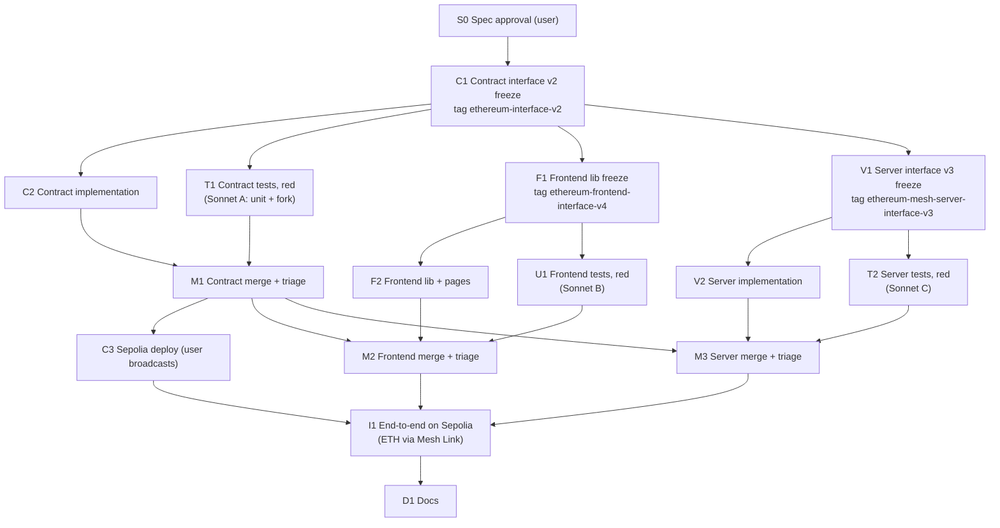

# Native ETH Invoices: Implementation Plan (DAG)

> Source spec: [`../spec/native-eth-spec.md`](../spec/native-eth-spec.md) (the "ETH spec"). Builds on [`implementation-dag.md`](implementation-dag.md) (the port) and [`mesh-pay-now-dag.md`](mesh-pay-now-dag.md) (Pay with Mesh), and uses the same test protocol. Written 2026-11-03.

## Decisions made while planning

| Topic | Decision |
|---|---|
| Design | ETH spec §2. User decisions: `token == address(0)` is ETH; push with a pull fallback; `receive()` only while Active; tokens ETH, PYUSD, USDG and USDC |
| Interface tags | `ethereum-interface-v2` (contracts), `ethereum-frontend-interface-v4` (`src/lib/`), `ethereum-mesh-server-interface-v3` (server). Each is the user's approved change (this plan) |
| Who writes tests | **Sonnet 5.5 sub-agents, black-box, after each freeze**: agent A for contracts, B for the frontend, C for the server. Implementers write no tests |
| Isolation | As in the Mesh plan's v2 change: each freeze is committed on a branch from the **previous stub tag** of that package (`ethereum-interface-v1`, `ethereum-frontend-interface-v1`/`-v2`, `ethereum-mesh-server-interface-v2`), with the current docs brought over, so test agents see stubs only. The implementation branch merges each tag and fills the stubs |
| Ops | **The user broadcasts** the new factory (C3). Claude writes the command |
| Branch | Continue on `ethereum-mesh-pay-now` |

## The DAG

**Parallelism:** after C1, three freezes (C1 itself, F1, V1) feed six independent nodes: C2, T1, F2, U1, V2 and T2. M2 and M3 wait for M1 only so that the ABI they build against comes from the merged contracts (`corepack pnpm sync-abi`).

**Critical path:** S0 → C1 → T1 (the largest test addition) → M1 → C3 → I1 → D1.

## Nodes

### S0 — Spec approval (user)

**Verify:** the user approves `native-eth-spec.md`.

**Status:** done 2026-11-03.

### C1 — Contract interface v2 freeze (main session)

On a branch from `ethereum-interface-v1` (stubs), with `ethereum/docs` brought over:

- `InvoiceEscrow.sol`: `fund` becomes `payable`; add `withdraw(address)`, `owed(address)` and `receive()`; add the 4 errors and 3 events (ETH spec §3.9); add the `PUSH_GAS` constant. NatSpec for every rule in ETH spec §3, including check order, the `_send` contract (gas cap, no return-data copy, zero amount skipped, credit on failure) and the storage layout. Bodies are stubs.
- `InvoiceFactory.sol`: NatSpec for `token == address(0)`.
- Update the `INTERFACE FREEZE` comments to `ethereum-interface-v2`; save the ABI in `contracts/abi/`; `corepack pnpm sync-abi`.
- Commit, tag `ethereum-interface-v2`, then launch agent A.

**Verify:** `forge build`; the ABI diff against v1 shows exactly ETH spec §3.9.

**Status:** done 2026-11-03, tag `ethereum-interface-v2` (branch `ethereum-eth-contract-freeze`, from `ethereum-interface-v1`, with the current tests and docs). The ABI diff is exactly §3.9; the factory ABI is unchanged. One addition, ETH spec §3.8a: the implementation's constructor sets status Cancelled. Because the escrow now has `receive()`, Solidity requires `InvoiceEscrow(payable(addr))` casts: 16 sites in the existing tests need that mechanical change (agent A).

### C2 — Contract implementation (main session)

Merge the tag into the implementation branch and fill in the bodies: `_send` in assembly (call with gas cap, `value`, out size 0); `withdraw` effects before the call; `receive` checks; `settleDirect` and `cancel` via `_send` for ETH. The ERC-20 paths stay byte-for-byte equivalent in behaviour.

**Verify:** `forge build`; ABI identical to the tag (plus library errors, as in the port's C2 note). No tests here.

**Status:** done 2026-11-03. `_pay(to, amount)` dispatches to `safeTransfer` (ERC-20, so those paths are unchanged) or `_send` (ETH: assembly `call(PUSH_GAS, to, amount, 0, 0, 0, 0)`, credit plus `PayoutDeferred` on failure). `withdraw` uses an assembly call with all gas and no return-data copy. ABI identical to the tag apart from the library errors and `getInvoice`'s unnamed return, as at the port's C2. ABIs synced to the frontend and mesh-server. The existing tests don't compile until M1 (the `payable` casts, agent A).

### T1 — Contract tests, red (Sonnet agent A)

Extend the port's suite (it stays as is and must keep passing):

- **Mocks:** `RejectingReceiver`, `GasBurner`, `ReturnBomb`, and a reentrant receiver for each of `triggerPayment`, `cancel`, `settleDirect` and `withdraw`.
- **Unit tests:** every ETH spec §6 contract case.
- **Fork test:** the ETH lifecycle on Sepolia, plus `createInvoice` gas with ETH.
- **Spec questions:** in `test/SPEC_QUESTIONS.md` under "ETH".

**Verify:** every new test red against the v2 stubs; the existing ERC-20 tests fail too (stubs), as before.

### M1 — Contract merge + triage (main session; user decides spec gaps)

As port M1: `forge test`, the fork suite, `forge coverage` at 100% of `src/`. Findings go in `test-lane-findings.md` under "Native ETH: contracts".

### C3 — Sepolia deploy (user broadcasts)

Same command as the port (`--gas-estimate-multiplier 800`). Update `contracts/deployments/sepolia.json` (keep the old addresses under `previous`), the frontend `.env`, and mesh-server's `FACTORY_ADDRESS`.

**Verify:** both contracts verified on Sourcify; `implementation()` matches; the implementation's code contains the `withdraw(address)` selector.

### F1 — Frontend lib freeze (frontend agent)

On a branch from `ethereum-frontend-interface-v2` stubs plus the v3 type changes (or from `-v3` with its changed modules stubbed), with the current docs:

- `lib/tokens.ts` (new).
- `fundPath` gains the native path.
- `actions` gains `owed` and `withdraw`.
- `history` gains the `Received`, `PayoutDeferred` and `Withdrawn` log types and the native inbound source.
- `config.ts` data, written in full: ETH in `TOKENS` and `MESH_TOKENS`.

Stubs and TSDoc; tag `ethereum-frontend-interface-v4`; then launch agent B.

### F2 — Frontend lib + pages (frontend agent)

Lib bodies, `useFund` (native path), `useInvoiceWrite` for withdraw, `CreateInvoice` (ETH without `decimals()`), `InvoiceDetail` (`getBalance`, ETH amounts, Withdraw), and the history rows.

**Verify:** build and lint (test files may lag until M2).

### U1 — Frontend tests, red (Sonnet agent B)

ETH spec §6, frontend items; the existing suites are updated for the new `ActionContext` and `fundPath` fields.

### M2 — Frontend merge + triage

`corepack pnpm sync-abi` from the M1 contracts; test, build, lint; findings under "Native ETH: frontend".

### V1 — Server interface v3 freeze (main session)

On a branch from `ethereum-mesh-server-interface-v2` (stubs): `invoice.ts` `tokenBalance` TSDoc (native), new `tokenDecimals`; `app.ts` TSDoc (`decimals` via `tokenDecimals`); `.env.example` (`MESH_TOKENS` with ETH). Tag `ethereum-mesh-server-interface-v3`; launch agent C.

### V2 — Server implementation (main session)

**Verify:** typecheck; declarations identical to the tag; live: a sandbox session for an ETH clone on the new factory (after C3).

### T2 — Server tests, red (Sonnet agent C)

ETH spec §6, server items, added to agent A's mesh-server suite (a fresh Sonnet agent, briefed with that suite's conventions).

### M3 — Server merge + triage

As before; findings under "Native ETH: mesh-server".

### I1 — End-to-end on Sepolia (user, with Claude)

A new section in [`../e2e-checklist.md`](../e2e-checklist.md); the Mesh plan's I1/I2 are folded into it:

1. **ETH via Mesh**, with no wallet connected to the app: create an ETH invoice, Pay with Mesh, MetaMask in Link on Sepolia. Check the transfer, the `Received` event, `transfer.completed`, `settleDirect`, the payout, Paid status, history and "Paid via Mesh" (also as the seller).
2. **ETH fund → trigger** in a discount tier; **cancel** of a funded ETH invoice.
3. **Withdraw:** fund an ETH invoice with a refund address that is a contract rejecting ETH (a small helper deployed by the user), trigger, then withdraw the credit to an EOA.
4. **PYUSD regression:** fund → trigger, and a Mesh session that reaches Link (ERC-20 in the sandbox is still the open Mesh question).

**Verify:** every item ticked with tx hashes.

### D1 — Docs

`CLAUDE.md` (new factory and tags), spec statuses, `mesh-server/README.md` (Mesh v2 setup, ETH token entry).

## Open risks

| Risk | Mitigation |
|---|---|
| `PUSH_GAS = 50_000` is too low for some smart wallets | They get a credit and withdraw; documented (ETH spec §3.11) |
| The ETH change breaks an ERC-20 path | The whole port suite runs unchanged against the new contract (T1, M1) |
| The Sepolia deploy needs more gas than forge estimates | The port's `--gas-estimate-multiplier 800` |
| Mesh delivers less ETH than quoted (fees) | The balance check refuses to settle; observed in I1 |
| A test agent reads the implementation | Stub-lineage tags, as in the Mesh v2 change; file lists checked at each merge |
