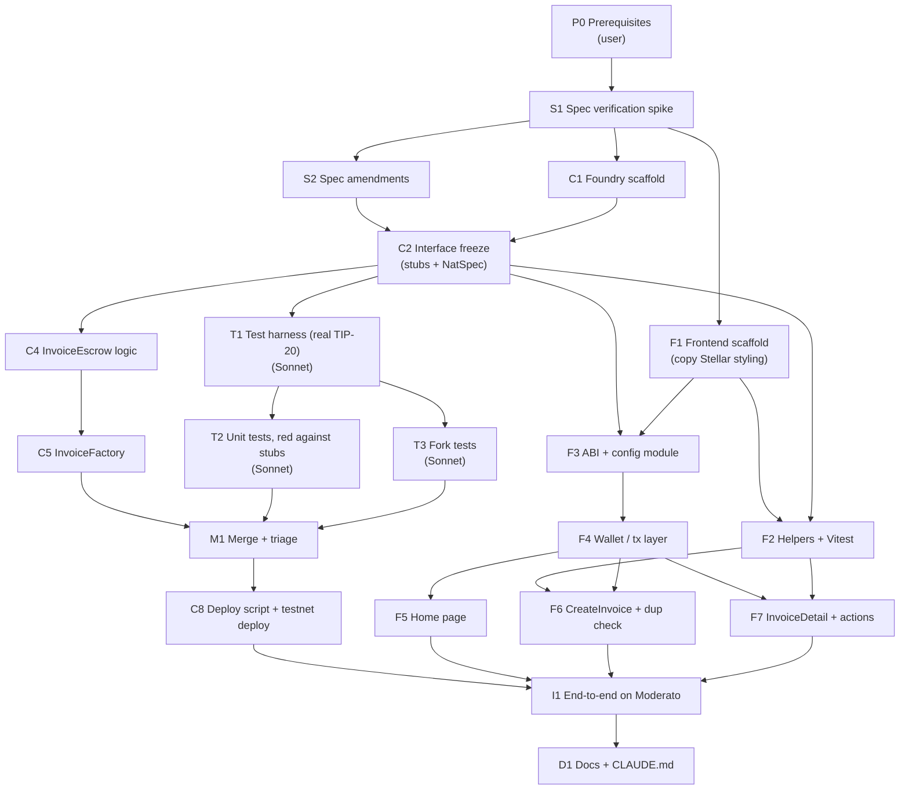

# InvoiceDiscount on Tempo: Implementation Plan (DAG)

> Source spec: [`tempo/docs/spec/invoice-discount-spec.md`](../spec/invoice-discount-spec.md). Written 2026-10-18, revised 2026-10-19 to add an independent test lane, and again after S1 to use real local TIP-20 instead of a mock.

## Decisions made while planning

| Topic | Decision |
|---|---|
| Test environment | **Real local TIP-20 + fork.** S1 showed the Tempo Foundry build runs the TIP-20 precompiles in plain `forge test`. Unit tests create tokens with `TIP20_FACTORY.createToken`, grant `ISSUER_ROLE` and `mint`; no mock. A separate forked-Moderato suite covers the live token set (OUSD, a non-TIP-20 address). Fork accounts are funded with `vm.prank(holder)` + `transfer`, since `deal` fails on TIP-20 |
| DAG shape | Three lanes in parallel once the interface is frozen (node C2): **contracts** (main session), **contract tests** (separate Sonnet 5.5 sub-agent), **frontend**. Every node has a verify step |
| Independent tests | Contract tests are written **black-box** by a different model (Sonnet 5.5) from the spec and the frozen interface only, without seeing the implementation. See [Test lane protocol](#test-lane-protocol) |
| Ops | **The user runs** toolchain installs, key handling and the testnet broadcast. Claude writes the code, scripts and commands |
| Extras beyond the spec | Frontend unit tests (Vitest), Stellar UI styling copied as a starting point (not shared), and an early spec-verification spike |
| `NotTIP20` check | `TIP20_FACTORY.isTIP20(token)` (prefix **and** code), not a prefix-only check. Spec §3.5 amended in S2 |
| Frontend package manager | **pnpm** via `corepack pnpm@9`. The WSL `npm` is the Windows binary and fails on WSL paths |
| Factory/implementation cycle | **The factory deploys the implementation** in its constructor: `implementation = address(new InvoiceEscrow())`, and `InvoiceEscrow` sets `factory = msg.sender` (immutable). The factory constructor takes **no arguments**. This amends spec §3.4 (applied in node S2) |

## What this plan is set up to test

1. **Tests can start as soon as the interfaces are designed.** The test lane forks from the C2 commit, where every function is a stub, and finishes its suite while C4/C5 are still being written.
2. **A different model writing the tests gives adversarial verification.** The test author (Sonnet 5.5) sees the spec and the interface but never the implementation (Opus, main session). Each disagreement found when the two branches merge (node M1) is logged and classified. That log is how the experiment is measured.

## Assumptions (to be confirmed or overturned in S1)

**Resolved in S1** (see [`verification-notes.md`](../spec/verification-notes.md)): plain `foundryup` gives the Tempo build (`foundryup -n tempo` is deprecated); `tempo-std` `ITIP20` has the memo functions; the TIP-20 prefix is confirmed and `isTIP20` also checks code; `tempoWallet`, batched `calls` and `*Sync` actions exist; `deal` fails on a fork but a holder `prank` works; real TIP-20 runs locally. **Still open:** `feePayer: true` on arbitrary contract writes (settled in F4), and the `accounts` peer-version mismatch (settled in F1).

- The `activeDiscount` parameter is named `timestamp`, not `now`. `now` is a reserved word in Solidity ≥0.7, and the parameter name doesn't change the ABI selector.

---

## The DAG

### Lanes and critical path

| Lane | Who | Nodes | Starts after |
|---|---|---|---|
| Setup | main session + user | P0 → S1 → S2 | — |
| Contracts | main session (Opus) | C1 → C2 → C4 → C5 | S1 |
| Contract tests | sub-agent (Sonnet 5.5), own worktree | T1 → {T2, T3} | C2 commit |
| Join | main session | M1 → C8 | C5, T2, T3 |
| Frontend | main session, or a third agent | F1 → F3 → F4 → {F5, F6, F7}, with F2 alongside | S1 (F1), C2 (F2, F3) |
| Integration | main session + user | I1 → D1 | C8 and F5–F7 |

**Critical path:** P0 → S1 → C1 → C2 → {C4 → C5 ‖ T1 → T2/T3} → M1 → C8 → I1 → D1. The fork tests (T3) and the testnet deploy (C8) are the riskiest steps, because they depend on how S1 turns out.

---

## Interface freeze (node C2)

C2 is what the test lane and the frontend lane both build against, so it must be complete enough that someone with only the spec and these files can write every test.

- Every external function, event, error, struct and enum exists with its **final signature**. Function bodies are `revert("unimplemented");` (or return a zero value for views).
- Every function has **NatSpec** stating its preconditions, effects, the error it reverts with for each failed check (in check order), and the events it emits. This mirrors spec §3.5 and is the test lane's contract.
- `InvoiceFactory` is a stub too: its constructor deploys the implementation, and `createInvoice` reverts.
- C2 ends with a **git commit** (and tag `tempo-interface-v1`). The test lane forks from this commit.
- **Change rule:** after the tag, the main session may not change any signature, event, error or NatSpec-described behaviour on its own. A change needs the user's approval and a new tag (`tempo-interface-v2`), which is then merged into the test and frontend branches.

---

## Test lane protocol

### Isolation
- The sub-agent runs in its own **git worktree** branched from `tempo-interface-v1` (Agent tool: `model: "sonnet"`, `isolation: "worktree"`). The implementation doesn't exist on that branch, so the test author can't read it, even by accident.
- The main session doesn't read or edit `test/unit/` or `test/fork/` before M1. Its own smoke checks go in `test/smoke/`.
- Neither side edits the other's files at any point, M1 included. Fixes go back to the file's owner.

### What the test agent is given
- `tempo/docs/spec/invoice-discount-spec.md` (as amended in S2)
- `tempo/docs/spec/verification-notes.md` (from S1: memo event signature, fork funding method)
- The frozen `src/InvoiceEscrow.sol` and `src/InvoiceFactory.sol` stubs
- This plan's T1–T3 node descriptions

### Brief for the sub-agent (paste as the Agent prompt)
> You are writing the Foundry test suite for InvoiceDiscount on Tempo, adversarially. Another model is implementing the contracts right now and you will not see its code. Your job is to find every way an implementation could be wrong with respect to the spec.
> Inputs: the spec, the verification notes, and the stub contracts in `tempo/contracts/src/` (signatures and NatSpec are final; bodies are stubs). Treat the spec as the source of truth; where the spec and NatSpec disagree, or the spec is ambiguous, do not guess. Record it in `tempo/contracts/test/SPEC_QUESTIONS.md` and write the test for the reading you think is right, marked `// SPEC-QUESTION n`.
> Deliver nodes T1, T2, T3 as described in `tempo/docs/plan/implementation-dag.md`. Beyond the 22 tests in spec §5, add tests for boundaries (exact cutoff, exact due date, 10 vs 11 tiers, 10_000 vs 10_001 bps, `uint128` max principal), every revert path, event arguments, and any state or balance an implementation could get subtly wrong. Test through the external interface only.
> Done when: `forge build` passes, and `forge test --match-path 'test/unit/*'` against the stubs shows **every test failing** (a test that passes against a stub is not testing anything; fix or justify it in SPEC_QUESTIONS.md). Commit on your branch and report the test count and the list of spec questions.

### Red check
A test that passes against the stubs is vacuous. Revert-path tests are the trap: a stub that reverts on everything satisfies `vm.expectRevert()` without a selector. So every `expectRevert` must name the **exact custom error selector**, and any test still green against the stubs is flagged in `SPEC_QUESTIONS.md`.

### Findings log (the experiment's measurement)
M1 produces `tempo/docs/plan/test-lane-findings.md`, one row per test that fails after merge or spec question raised:

| # | Test | Classification | Resolution |
|---|---|---|---|
| | | **impl bug** / **test bug** / **spec gap** | fixed by owner / spec amended (user decides) |

The summary counts each class, and records how many implementation bugs the independent tests caught that the main session's smoke tests missed.

---

## Nodes

### P0 — Prerequisites (user runs)

> **Status:** ✅ **Completed**
- Install Foundry: `curl -L https://foundry.paradigm.xyz | bash && foundryup` (the Tempo build; `-n tempo` is deprecated). **Done 2026-10-19: forge 1.8.5, deployer `0xA6C5…716d` funded.**
- Node ≥ 20 (v22 is already present in WSL).
- Create a deployer keystore: `cast wallet import tempo-deployer --interactive`. No raw private keys in `.env`.
- Fund the deployer: `cast rpc tempo_fundAddress <ADDR> --rpc-url https://rpc.moderato.tempo.xyz`.
- Set up Tempo Wallet (passkey) in the browser. Optionally MetaMask, with Moderato (chain 42431) added and funded, for testing the fallback path.

**Verify:** `forge --version` shows the Tempo build; `cast balance`/TIP-20 `balanceOf` on the deployer shows testnet AlphaUSD.

### S1 — Spec verification spike (main session, using Tempo docs)

> **Status:** ✅ **Completed**
Check each assumption above against the Tempo docs and the installed tooling:
1. TIP-20 address prefix rule (how many bytes, and whether OUSD `0x20c0…6a37da5c996874be` fits it).
2. `tempo-std` package name, install path, `ITIP20` function names, and the **memo event signature** (T1's mock must emit the same event).
3. Foundry Tempo support: `forge init -n tempo` template contents, fork testing against Moderato, Tempo-mode Anvil, `--tempo.fee-token`, the `--verify --verifier-url` flow.
4. How to give test accounts TIP-20 balances on a fork (needed by T3).
5. wagmi/viem Tempo APIs: `tempoWallet` options, `feePayer: true` on writes, batched `calls`, `*Sync` actions, the connector id `xyz.tempo`.
6. Moderato RPC `eth_getLogs` block-range limit (sets F6's page size).

**Output:** `tempo/docs/spec/verification-notes.md` with one line per item: confirmed / differs (with the correct value) / unknown. This is one of the test agent's inputs.
**Verify:** every item resolved or explicitly marked unknown with a fallback.

### S2 — Spec amendments

> **Status:** ✅ **Completed**
- Apply the factory-deploys-implementation change to §3.4/§3.5 (no-arg factory constructor; `implementation()` public getter; `factory = msg.sender` in the escrow constructor; the escrow constructor still marks the implementation initialised).
- Apply any S1 corrections (prefix rule, API names) and the `activeDiscount(uint64 timestamp)` rename. Show the diff to the user before saving.

**Verify:** the spec has no remaining "verify before relying on it" notes, or each one that remains links to `verification-notes.md`. The spec is final enough to be the test lane's source of truth.

### C1 — Foundry scaffold

> **Status:** ✅ **Completed**
- `tempo/contracts/` via `forge init -n tempo` (or plain `forge init` plus manual config if S1 says the template differs).
- Install `OpenZeppelin/openzeppelin-contracts` (for `Clones`) and `tempo-std`; set remappings.
- `foundry.toml`: pin `solc`, enable the optimizer, add an `[rpc_endpoints] moderato = "${TEMPO_RPC_URL}"` alias, and a `fork` profile limited to `test/fork/`.
- Test directories: `test/unit/`, `test/fork/`, `test/mocks/` (test lane) and `test/smoke/` (main session).
- `.env.example` with `TEMPO_RPC_URL=https://rpc.moderato.tempo.xyz`.

**Verify:** `forge build` succeeds on the empty project.

### C2 — Interface freeze (stubs + NatSpec)

> **Status:** ✅ **Completed**
See [Interface freeze](#interface-freeze-node-c2) for the rules.
- `src/InvoiceEscrow.sol`: `Status`, `DiscountTier`, `InvoiceState` at file level; all custom errors from §3.5; events from §3.6; storage variables in the §3.3 packed order; immutable `factory`; every function signature, stubbed, with full NatSpec.
- `src/InvoiceFactory.sol`: no-arg constructor that deploys the implementation, `implementation` getter, `InvoiceCreated` event, stubbed `createInvoice`.
- Commit and tag `tempo-interface-v1`. **Then launch the test sub-agent** (brief above).

**Verify:**
- `forge build` succeeds.
- `forge inspect InvoiceEscrow storageLayout` shows slot 0 = seller + dueDate + status + initialized, and tiers start at slot 7 or lower.
- Every external function has NatSpec naming its revert errors.
- `forge inspect InvoiceEscrow abi` and `forge inspect InvoiceFactory abi` saved as the frozen ABI.

### C4 — InvoiceEscrow logic (main session, in parallel with T1–T3)

> **Status:** ✅ **Completed**
Implement §3.5 exactly, without reading the test lane's branch:
- `constructor`: `factory = msg.sender`; mark initialised.
- `initialize`: all validations in the spec order; store `payoutAddress` only if non-zero and ≠ seller.
- `fund`, `triggerPayment`, `cancel`: checks-effects-interactions; status written before transfers; memo = `invoiceRef` on every transfer.
- `_payout()` and `_refund()` resolve the defaults; `getInvoice()` returns them resolved; `activeDiscount(uint64 timestamp)`.

**Verify:** `forge build`; the ABI diff against `tempo-interface-v1` is empty.

### C5 — InvoiceFactory (main session)

> **Status:** ✅ **Completed**
- `createInvoice`: `Clones.clone` → `initialize(msg.sender, …)` → emit `InvoiceCreated` → return.
- `test/smoke/Smoke.t.sol`: the main session's own minimal checks (create, fund, pay at one tier, cancel). It creates its own real local token (`createToken` + `mint`) in `test/smoke/`, separate from the test lane's harness.

**Verify:** `forge test --match-path 'test/smoke/*'` passes.

### T1 — Test harness (Sonnet sub-agent)

> **Status:** ✅ **Completed**
- `test/unit/Base.t.sol`: deploys the factory, creates a real TIP-20 with `StdPrecompiles.TIP20_FACTORY.createToken("T", "T", "USD", StdTokens.PATH_USD, address(this), salt)`, grants itself `ISSUER_ROLE` via `ITIP20RolesAuth`, and keeps an unprefixed address for the `NotTIP20` test (plus a prefixed address with no code). Named actors: seller, buyer, payout, refund, stranger. Helpers to mint, to `createInvoice` with default tiers, and to fund.
- Memo assertions use the real `TransferWithMemo` event (`verification-notes.md` item 2c).
- Beware: address literals need EIP-55 checksums.

**Verify:** `forge build` passes; a harness self-test mints, approves, and sees a `TransferWithMemo` event from a `transferWithMemo` call.

### T2 — Unit tests, red against stubs (Sonnet sub-agent)

> **Status:** ✅ **Completed**
- `test/unit/InvoiceEscrow.t.sol`: all 22 tests in spec §5, using `vm.warp` for the tier and due-date boundaries.
- `test_ValidationErrors` covers every error, one assertion each, with exact selectors.
- `test_TransfersCarryInvoiceRefMemo` uses `vm.expectEmit` on the real `TransferWithMemo` event.
- The §3.8 worked example as a table-driven test (day 5 / 20 / 45 / cancel).
- Adversarial extras the agent chooses, at minimum the boundaries listed in the brief.
- `test/SPEC_QUESTIONS.md` with every ambiguity found.

**Verify:** `forge test --match-path 'test/unit/*'` against the stubs: **every test fails** (red check). Committed on the test branch.

### T3 — Fork tests (Sonnet sub-agent)

> **Status:** ✅ **Completed**
- `test/fork/InvoiceFork.t.sol`, running only under the fork profile. Uses real AlphaUSD, funding accounts by `vm.prank(holder)` + `transfer` (`deal` fails; see the verification notes).
- Cases:
  - happy path with the real memo events
  - `NotTIP20` against a real non-TIP-20 address
  - OUSD (the odd-address token) accepted
  - gas snapshot of `createInvoice` with 0, 3 and 10 tiers, to confirm the fresh-slot count
- If S1 confirms Tempo-mode Anvil, the same suite also runs against it.

**Verify:** compiles; red against the stubs on a fork (`FOUNDRY_PROFILE=fork forge test`, with `TEMPO_RPC_URL` set; plain `forge test` skips `test/fork/`).

### M1 — Merge + triage (main session, user decides spec gaps)

> **Status:** ✅ **Completed**
1. Merge the test branch into the contract branch.
2. Run `forge test` (unit) and the fork suite.
3. For every failure and every entry in `SPEC_QUESTIONS.md`, classify it as impl bug, test bug or spec gap, and log it in `test-lane-findings.md`.
   - **Impl bug:** the main session fixes `src/`.
   - **Test bug:** sent back to the Sonnet agent (SendMessage, same agent) to fix in its own files.
   - **Spec gap:** the user decides; the spec is amended, then whichever side is wrong fixes its code.
4. Repeat until everything is green.
5. Run `forge coverage` and note any uncovered lines in the findings log (tests for them go back to the test agent).

**Verify:** the full unit and fork suites pass; `forge coverage` shows 100% line coverage of `src/`; the findings log is complete with a summary.

### C8 — Deploy script + testnet deploy

> **Status:** ⏳ **Pending**: script written and simulated; the user still has to broadcast it.
- `script/Deploy.s.sol`: deploys `InvoiceFactory` (which deploys the implementation) and logs both addresses and the block number.
- Claude provides the exact command (spec §6, using `--account tempo-deployer`). **The user broadcasts it.**
- After the deploy, write `tempo/contracts/deployments/moderato.json` with `{ factory, implementation, deployBlock }`.

**Verify:** both contracts are verified on contracts.tempo.xyz; `cast call <factory> "implementation()"` returns the implementation address.

### F1 — Frontend scaffold (copy Stellar styling)

> **Status:** ✅ **Completed**
- `tempo/frontend/`: Vite + React + TS + Tailwind v4 + react-router, on the same major versions as `stellar/frontend`.
- **Copy** (not import) `index.css`/`App.css` styling, the layout shell and `hero.png` from `stellar/frontend`. Drop all Stellar/Freighter code.
- Add `wagmi`, `viem` and `@tanstack/react-query`.

**Verify:** `npm run build` and `npm run lint` pass; the shell renders three empty routes.

### F2 — Helpers + Vitest

> **Status:** ✅ **Completed**
- `src/lib/units.ts`: `toUnits` and `fromUnits`, taking decimals as a parameter that callers read from `decimals()`.
- `src/lib/ref.ts`: `encodeRef` (trimmed, ≤32 UTF-8 bytes), `decodeRef` and `refByteLength`.
- `src/lib/validation.ts`: a pure `validateInvoiceForm()` that mirrors §3.5 and returns per-field errors.
- Vitest tests:
  - multi-byte references (e.g. `INV-ü…` right at the 32-byte limit)
  - whitespace trimming
  - round trip with `decodeRef`
  - every validation rule
  - rounding in the split preview

**Verify:** `npm test` passes.

### F3 — ABI + config module

> **Status:** ✅ **Completed**
- `scripts/sync-abi` (an npm script) runs `forge inspect … abi --json` into `src/abi/*.ts` as `as const`, so wagmi types the calls.
- `src/config.ts`: `tempoModerato` chain, the two connectors (exact options per S1), the token list from §4.1, and `VITE_FACTORY_ADDRESS`/`VITE_FACTORY_DEPLOY_BLOCK` from `.env` (`.env.example` committed).

**Verify:** `tsc --noEmit` passes; the typed `readContract(getInvoice)` compiles.

### F4 — Wallet / tx layer

> **Status:** ✅ **Completed** (code, tests, build and lint pass). ⏳ Manual browser check still to do (connect/disconnect with both wallets, `feePayer: true` on a real write).
- `useWalletMode()`: tells Tempo Wallet (`xyz.tempo`) from an injected wallet.
- `useInvoiceWrite()`: on Tempo Wallet, adds `feePayer: true` and uses the `*Sync` action; on an injected wallet, does a plain write and then `waitForTransactionReceipt`. Exposes pending / success / error state.
- `useFund()`: on Tempo Wallet, one batched `calls: [approve, fund(refund)]`; on an injected wallet, `approve` then `fund`.
- A connect UI with a Tempo Wallet button, an "other wallet" option, and a fee note for injected users.

**Verify:** connect and disconnect work with both wallets in `npm run dev`; a no-op read works.

### F5 — Home page

> **Status:** ✅ **Completed** (code, tests, build and lint pass). ⏳ Manual browser check still to do.
Hero, Create CTA, address lookup (`isAddress`), and the three-step "How it works".

**Verify:** an invalid address shows an error; a valid one navigates to `/invoice/:address`.

### F6 — CreateInvoice + duplicate check

> **Status:** ✅ **Completed** (code, tests, build and lint pass). ⏳ Manual browser check still to do (duplicate check against the deployed factory).
- Form per §4.3: live byte counter, token dropdown, tiers editor (max 10), optional payout address.
- Duplicate check: paginated `getLogs` on `InvoiceCreated`, filtered by the indexed `seller` + `invoiceRef`, from `VITE_FACTORY_DEPLOY_BLOCK`, with the page size from S1. Runs on input (debounced) **and again right before sending**.
- Submit through `useInvoiceWrite`; read the new address from the `InvoiceCreated` log in the receipt; show a success screen with copy and open buttons.

**Verify:** client validation blocks every invalid case; a duplicate reference is blocked with a link to the existing invoice (manual, against the C8 deploy, or Anvil if S1 confirms it).

### F7 — InvoiceDetail + actions

> **Status:** ✅ **Completed** (code, tests, build and lint pass). ⏳ Manual browser check still to do.
- `getInvoice` plus `activeDiscount(now)`; reference shown prominently; addresses tagged "you" where they apply; active tier highlighted; current split preview.
- Action visibility per the §4.3 table. Each action states where the money goes before signing, then refetches after the write.

**Verify:** the action-visibility logic is a pure function with Vitest tests covering every role × status × before/after due date.

### I1 — End-to-end on Moderato

> **Status:** ⏳ **Pending**
Manual script in `tempo/docs/e2e-checklist.md`, using tier cutoffs **minutes** apart so tier changes are observable:
1. Seller (Tempo Wallet) creates an invoice with a payout address. The duplicate reference is blocked.
2. Buyer (second passkey account) funds with a refund address in one batched, sponsored tx.
3. Trigger in tier 1, then on a second invoice after the cutoff. Check both splits against `activeDiscount`.
4. Seller cancels an unfunded invoice; seller cancels a funded one; buyer cancel blocked before due, allowed after.
5. Repeat the fund + pay steps with MetaMask (two txs, user pays fees).
6. Check the memos on the explorer for every transfer.

**Verify:** every checklist item is ticked, with tx hashes recorded.

### D1 — Docs

> **Status:** ⏳ **Pending**
- Root `CLAUDE.md`: Tempo build, test, deploy and frontend commands (spec §6).
- `tempo/README.md`: setup, the env vars, and the §3.9 TIP-20 risks.
- Spec status changed from draft to implemented.
- The test-lane findings summary linked from the README.

**Verify:** a fresh clone can follow the README to `forge test` and `npm run dev`.

---

## Open risks

| Risk | Affects | Mitigation |
|---|---|---|
| Tempo Foundry can't fork-test precompiles, or can't give test accounts balances | T3 | Fall back to Tempo-mode Anvil; otherwise do the T3 checks as a scripted run against Moderato with real faucet funds |
| The TIP-20 prefix rule differs from the spec (e.g. OUSD doesn't match) | C4, T2, T3 | S1 decides before the freeze; worst case, drop `NotTIP20` or check through the TIP-20 Factory registry if one exists |
| The interface is incomplete or wrong after the freeze | test + frontend lanes | Change rule: user approval, new tag, merged into both branches |
| Tests pass against stubs (vacuous) | T2, T3 | Red check plus exact error selectors on every `expectRevert` |
| The test agent copies the implementation's mistakes | the experiment | It can't: the implementation isn't on its branch, and the main session doesn't read the tests before M1 |
| wagmi Tempo API names differ from the spec | F3, F4 | S1 pins them before F1 starts |
| The RPC caps `getLogs` ranges tightly | F6 | Paginate with the S1 page size; the deploy block keeps the range small |
