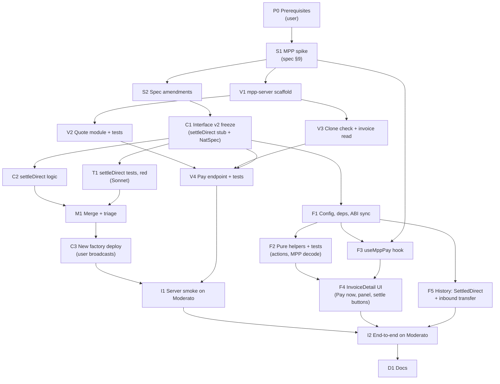

# Pay Now via MPP: Implementation Plan (DAG)

> Source spec: [`tempo/docs/spec/mpp-pay-now-spec.md`](../spec/mpp-pay-now-spec.md) (the "MPP spec"). Builds on the base plan [`implementation-dag.md`](implementation-dag.md). Written 2026-10-19.

## Decisions made while planning

| Topic | Decision |
|---|---|
| Interface change | `settleDirect`, `NothingToSettle`, `InsufficientDirectPayment` and `SettledDirect` are an interface change, so they go through the base plan's change rule: stubs + NatSpec, then tag **`tempo-interface-v2`** (node C1). The MPP spec is the user's approval for the change |
| Contract tests | **Same protocol as the base plan**: a Sonnet 5.5 sub-agent writes the MPP spec §6.1 tests black-box in its own worktree from the v2 tag, and M1 logs the disagreements in [`test-lane-findings.md`](test-lane-findings.md) (user-confirmed) |
| Server HTTP layer | **Hono** + `@hono/node-server`. `mppx/server` takes a Fetch `Request` and returns a `Response`; Hono gives that on Node, plus a CORS middleware (user-confirmed; the alternative was plain `node:http` with a Request/Response adapter) |
| Server package manager | **pnpm** via `corepack pnpm@9`, as in the frontend (the WSL `npm` is the Windows binary) |
| Server tests | Vitest. Chain reads are faked with a viem `custom({ request })` transport that answers `eth_getCode` / `eth_call` / `eth_getBlockByNumber` from fixtures (`encodeFunctionResult`). No dependency-injection layer |
| Settler key | A **throwaway testnet key** in `tempo/mpp-server/.env` (gitignored), generated with `cast wallet new` and funded by the user. This departs from the base plan's "no raw keys in `.env`" rule, which was about the deployer. The key has no rights in the contract (user-confirmed, for now) |
| Ops | As in the base plan: **the user runs** key generation, funding and the factory broadcast. Claude writes code, scripts and commands |
| Old factory | Left as is. Invoices from `0x9e9f…0fC` keep working through fund → trigger. The frontend points at the new factory only, so they stop being listed |

## What depends on the spike (S1)

The MPP spec §9 lists five things that follow from the docs but haven't been tried. Each one changes a specific node, so S1 resolves them first and records the results in [`verification-notes.md`](../spec/verification-notes.md) under a new "MPP" heading:

| §9 item | If it holds | If it doesn't | Affects |
|---|---|---|---|
| 1. wagmi `tempoWallet` connector gives `mppx` a signing account | `useMppPay` builds the client from `useConnectorClient()` | Create an Accounts SDK `Provider({ mpp: false })` for this flow only | F3 |
| 2. Credential re-check vs. a fresh quote | Recompute the quote on the retry; it matches | Rebuild the charge request on the retry from the echoed Challenge (after verifying it), not from a fresh quote | V4 |
| 3. Tempo Wallet signs a sponsored "pull" Credential | `tempo.charge({ feePayer })` on the server | Drop `feePayer`; the wallet broadcasts with its own sponsorship ("push") | V4, F3 |
| 4. CORS header names in the installed `mppx` | `Authorization` / `WWW-Authenticate` / `Payment-Receipt` | Use the names `mppx` actually reads and writes | V1, F2 |
| 5. EIP-1167 runtime bytes | `363d3d373d3d3d363d73<impl>5af43d82803e903d91602b57fd5bf3` (45 bytes) | Use the bytes read from a deployed clone | V3 |

Item 5 can be checked against any clone of the **current** factory, since the clone code doesn't depend on the implementation's contents.

---

## The DAG



### Lanes and critical path

| Lane | Who | Nodes | Starts after |
|---|---|---|---|
| Setup | main session + user | P0 → S1 → S2 | — |
| Contract | main session (Opus) | C1 → C2 | S2 |
| Contract tests | sub-agent (Sonnet 5.5), own worktree | T1 | C1 tag |
| Join | main session + user | M1 → C3 | C2, T1 |
| Server | main session, or a second agent | V1 → {V2 ‖ V3} → V4 | S1 (V1); C1 (V4) |
| Frontend | main session, or a third agent | F1 → {F2, F3, F5} → F4 | C1 (F1); S1 (F3) |
| Integration | main session + user | I1 → I2 → D1 | C3, V4, F4, F5 |

**Critical path:** P0 → S1 → S2 → C1 → {C2 ‖ T1} → M1 → C3 → I1 → I2 → D1. The contract change is small, so in practice the server lane (V4) is likely to finish last; V1–V3 can start right after S1, before C1.

**Parallelism after C1:** C2, T1, V2/V3/V4, F1→F2/F3/F5 have no dependencies on each other. Nothing outside the contract lane needs the new factory deployed until I1: the server tests use a fake transport, and the frontend builds against the stub ABI.

---

## Interface freeze v2 (node C1)

Same rules as base plan "Interface freeze (node C2)":

- Add to `InvoiceEscrow.sol` with final signatures: `function settleDirect() external`, `error NothingToSettle()`, `error InsufficientDirectPayment(uint256 balance, uint256 due)`, `event SettledDirect(address indexed caller, address payoutAddress, uint256 amount, uint16 discountBps)`. The body is `revert("unimplemented");`.
- NatSpec in the existing style: checks in order (`NotActive` → `NothingToSettle` → `InsufficientDirectPayment` unless the caller is the seller), effects (`status = Paid` before the transfer), the interaction (`transferWithMemo(payout, balance, invoiceRef)`, the whole balance), and the event. `buyer` and `refundAddress` stay zero.
- Update the `INTERFACE FREEZE` comment to name `tempo-interface-v2`.
- Regenerate the frozen ABI in `tempo/contracts/abi/InvoiceEscrow.json` and `tempo/frontend/src/abi/` (`corepack pnpm sync-abi`), so the server and frontend lanes build against the final ABI.
- Commit and tag `tempo-interface-v2`.

**Verify:** `forge build` passes; existing `forge test` still passes (no behaviour change); `git diff tempo-interface-v1.1 -- contracts/abi` shows only the four additions.

---

## Nodes

### P0 — Prerequisites (user runs)

> **Status:** ✅ **Completed** 2026-10-19

- Settler key: `cast wallet new`, then `cast rpc tempo_fundAddress <SETTLER_ADDR> --rpc-url https://rpc.moderato.tempo.xyz`.
- MPP secret: `openssl rand -hex 32`.
- A second Tempo Wallet passkey account (the payer) in a separate browser profile, funded with AlphaUSD. The base e2e checklist's buyer account works.

**Verify:** the settler's fee-token balance is non-zero.

### S1 — MPP spike (main session)

> **Status:** ✅ **Completed** 2026-10-19. Results: [`verification-notes.md` → MPP pay-now spike](../spec/verification-notes.md#mpp-pay-now-spike-s1-of-planmpp-pay-now-dagmd). Item 2 differs (reuse the echoed Challenge on the retry), item 3 differs (push mode, so the server has no `feePayer`), item 4 differs (`Accept-Payment` also needs CORS), and there is one new must-fix (`tempoWallet({ mpp: false })`, see F1). Items 1, 3 and 1b were settled from source, not live with a passkey; the first wallet payment in I2 confirms them. Item 5 was probed.

Resolve the five items in [What depends on the spike](#what-depends-on-the-spike-s1), using the Tempo/MPP docs and a throwaway script in the scratchpad (not checked in):

1. Install `mppx` in a scratch dir and pin the version. Confirm the names the spec uses exist: `Mppx.create`, `tempo.charge`, `mppx.charge(...)(request)`, `result.status`, `result.challenge`, `result.withReceipt`, `Expires.minutes`, `Challenge.fromHeaders`, the client's `polyfill: false` and `mppx.fetch`, and how the Receipt's `reference` and the Credential header are exposed.
2. Read how `mppx/server` validates a Credential on the retry (item 2).
3. In a scratch Vite page, connect Tempo Wallet through the existing wagmi config, build an `mppx` client from it and pay a scratch `mppx` server a small amount (items 1, 3, 4). That one run answers all three.
4. `cast code <existing clone>` and compare to the expected runtime (item 5).

**Verify:** each item has a recorded answer (with the `mppx` version) in `verification-notes.md`.

### S2 — Spec amendments (main session, user approves)

> **Status:** ✅ **Completed** 2026-10-19 (approved by the user)

Apply S1's outcomes to the MPP spec (§4.3, §5.1, §9) and mark §9 items as resolved, the same way base plan S2 amended the base spec.

**Verify:** the user approves the diff to `mpp-pay-now-spec.md`.

### C1 — Interface v2 freeze

> **Status:** ✅ **Completed** 2026-10-19, tag `tempo-interface-v2`. Existing 103 tests green; ABI diff is the four additions only.

See [Interface freeze v2](#interface-freeze-v2-node-c1).

### C2 — `settleDirect` logic (main session)

> **Status:** ✅ **Completed** 2026-10-19. Two smoke tests in `test/smoke/`; 105 tests green.

Implement MPP spec §3.1 in `InvoiceEscrow.sol`, reusing `_activeDiscount`, `_payout()` and `BPS_DENOMINATOR`. `due` uses the same rounding as `triggerPayment` (`principal - principal * bps / 10_000`). No new storage. Main-session smoke checks go in `test/smoke/` only; it doesn't read `test/unit/` until M1.

**Verify:** `forge build`; a smoke test that transfers `due` into a clone and calls `settleDirect` from a stranger; `forge test` shows the existing suite still green.

### T1 — `settleDirect` tests, red against stubs (Sonnet sub-agent)

> **Status:** ✅ **Completed** 2026-10-19. 37 tests, 37/37 red against the stub.

Agent tool with `model: "sonnet"`, `isolation: "worktree"`, branched from `tempo-interface-v2`. Brief: the base plan's [brief](implementation-dag.md#brief-for-the-sub-agent-paste-as-the-agent-prompt), with these inputs instead: the MPP spec §3 and §6.1, the v2 stubs, and `test/unit/Base.t.sol` (extend it, don't fork it: add the `SettledDirect` event mirror). Write a new `test/unit/InvoiceEscrowSettleDirect.t.sol` with the 8 tests in §6.1 plus boundaries: exact `due` vs `due - 1`, `due` at 0 bps and 10_000 bps (`due == 0`, so any positive balance settles), a seller calling with balance 0, the `TransferWithMemo` event's arguments, and `buyer`/`refundAddress` still zero in `getInvoice()` after settling. Spec questions go in `test/SPEC_QUESTIONS.md` under a new "MPP" heading. Every `expectRevert` names the exact selector.

**Verify:** `forge test --match-path 'test/unit/InvoiceEscrowSettleDirect.t.sol'` against the stubs: every test fails. Report the test count and spec questions.

### M1 — Merge + triage (main session)

> **Status:** ✅ **Completed** 2026-10-19. 142/142 green with no fixes; see [`test-lane-findings.md`](test-lane-findings.md#mpp-pay-now-settledirect-node-m1-of-mpp-pay-now-dagmd).

Merge T1's branch. Run the full suite. For each failing test or spec question, add a row to `test-lane-findings.md` under a new "MPP pay-now" section (impl bug / test bug / spec gap), and send fixes to the file's owner.

**Verify:** `forge test` all green; findings rows written.

### C3 — New factory deploy (user broadcasts)

Same `script/Deploy.s.sol` (no change needed). Claude writes the command; the user runs it. Then update `contracts/deployments/moderato.json`, the frontend `.env` (`VITE_FACTORY_ADDRESS`, `VITE_FACTORY_DEPLOY_BLOCK`), and the addresses at the top of `docs/e2e-checklist.md`. Keep the old factory's address in `deployments/` under a `previous` key for reference.

**Verify:** `cast call <factory> "implementation()"` returns an address whose code contains the `settleDirect()` selector (`cast sig "settleDirect()"`).

### V1 — `tempo/mpp-server/` scaffold

> **Status:** ✅ **Completed** 2026-10-19

`package.json` (`"type": "module"`, `dev` via `tsx watch`, `test` via `vitest run`), `tsconfig.json`, `.env.example` with the six vars from MPP spec §4.1, `.gitignore` (`.env`, `node_modules`). Dependencies: `mppx@0.13.5`, `viem`, `hono`, `@hono/node-server`. `src/env.ts` reads and checks the env once at startup. `src/index.ts`: a Hono app with CORS from MPP spec §4.4 (allow `Authorization` and `Accept-Payment`; expose `WWW-Authenticate` and `Payment-Receipt`) and a `GET /health` route. The server is its own package, so it gets its own copy of the ABIs: extend `frontend/scripts/sync-abi.mjs` to also write `mpp-server/src/abi/`, rather than importing across packages.

**Verify:** `corepack pnpm dev` starts; `curl -i -X OPTIONS` from `ALLOWED_ORIGIN` shows the allowed and exposed headers.

### V2 — Quote module (`src/quote.ts`) + tests

> **Status:** ✅ **Completed** 2026-10-19 (11 tests)

MPP spec §4.2:

```ts
/** Smallest discount at any instant in [t, t + window]. `discountAt` calls the contract's activeDiscount. */
export async function quoteBps(t: bigint, cutoffs: bigint[], discountAt: (ts: bigint) => Promise<number>, window = 180n): Promise<number>
export function quoteAmount(principal: bigint, bps: number): bigint // principal - principal * bps / 10_000
```

Candidates are `t` and each cutoff `c` with `t < c ≤ t + window`. The function takes `discountAt` as a parameter so the tests don't need a chain; this is the one place the contract is called per candidate.

**Verify:** vitest cases from MPP spec §6.2: no tiers; inside a tier with no cutoff in the window; a cutoff in the window with decreasing tiers; a cutoff in the window where the next tier is **larger** (the quote keeps the current, smaller one); past the due date (0 bps). Plus: a cutoff exactly at `t + 180` counts, one at `t` doesn't (it's already past). `quoteAmount` matches the contract's rounding for an odd principal.

### V3 — Clone check + invoice read (`src/invoice.ts`)

> **Status:** ✅ **Completed** 2026-10-19 (5 tests)

- `isClone(client, factory, address)`: `getCode(address)` equals the EIP-1167 runtime (S1 item 5) with `factory.implementation()` spliced in. Cache `implementation()` for the process lifetime.
- `readInvoice(client, address)`: `getInvoice()`.

**Verify:** vitest with the fake transport: a clone of the configured implementation passes; a clone of a different implementation, an EOA (empty code) and a non-clone contract fail.

### V4 — Pay endpoint (`POST /invoices/:address/pay`) + tests

MPP spec §4.3, in `src/pay.ts`, mounted in `index.ts`:

1. `isAddress` → 400. `isClone` → 404. `getInvoice().status === Active` → else 409 with the status name.
2. First request: latest block timestamp → `quoteBps` → `quoteAmount`. Retry: reuse the echoed Challenge's `amount` and `description` once `Challenge.verify` passes (MPP spec §4.3 step 4).
3. `mppx.charge({ amount: formatUnits(amount, 6), currency, recipient, expires: Expires.minutes(2), description })(c.req.raw)`. Return the 402 as is.
4. After a successful charge, `writeContract` `settleDirect()` from the settler account and `waitForTransactionReceipt`. On revert, decode the custom error name (`BaseError.walk` → `ContractFunctionRevertedError.data.errorName`) into `settleError`.
5. Return `result.withReceipt(Response.json(body))` with the body from §4.3. `200` even when `settled: false`.

`decodeRef` is copied from `frontend/src/lib/ref.ts` (a separate package; nothing is shared between packages).

Accepted for the PoC, not handled: two concurrent pays for different invoices share the settler's nonce sequence; viem's default nonce handling is relied on.

**Verify:** vitest with the fake transport and a real `MPP_SECRET_KEY`: 400 for `0x123`; 404 for a non-clone; 409 for a Funded invoice; 402 whose decoded Challenge has the expected `amount`, `currency`, `recipient` and an `expires` about 2 minutes out. The paid path (Credential → settle) is covered by I1, not unit tests.

### F1 — Config, deps, ABI sync

- `config.ts`: `MPP_SERVER_URL` from `VITE_MPP_SERVER_URL` (undefined → Pay now hidden), in the same style as `FACTORY_ADDRESS`. Add it to `.env.example`.
- Add `mppx@0.13.5` (same as the server; separate from the 0.9.3 the `accounts` package bundles).
- `tempoWallet({ feePayer: SPONSOR_URL, mpp: false })`. **Required:** otherwise the Accounts SDK patches the global `fetch` and pays any 402 without asking (S1 item 1b).
- `src/abi/InvoiceEscrow.ts` already regenerated in C1; check it's committed.

**Verify:** `corepack pnpm build` and `corepack pnpm test` pass.

### F2 — Pure helpers + tests

- `lib/actions.ts`: extend `ActionContext` with `walletMode`, `cloneBalance` and `dueNow` (the amount due at the current discount), and `VisibleActions` with `payNow`, `finishSettlement`, `acceptAndSettle`, using the rules in MPP spec §5.1. `payNow` also needs `MPP_SERVER_URL` set; pass it in as a boolean so the function stays pure.
- `lib/mpp.ts`: turn a 402 `Response` into the panel's Challenge view (status, raw `WWW-Authenticate`, decoded `amount`/`currency`/`recipient`/`expires`/`description`), and a `Payment-Receipt` header into the Receipt view (`method`, `reference`, `status`, `timestamp`). Uses `mppx`'s own decoders (`Challenge.fromHeaders`, the Receipt equivalent found in S1).

**Verify:** `actions.test.ts` gains a case per new action and its negatives (seller doesn't see Pay now; injected wallet doesn't; Funded doesn't; `acceptAndSettle` only when `0 < balance < dueNow`; `finishSettlement` when `balance ≥ dueNow`). `mpp.test.ts` decodes a fixture header captured in S1.

### F3 — `useMppPay` hook

`hooks/useMppPay.ts`, two steps the UI calls separately:

- `quote(invoice)`: plain `fetch(POST url)` with no Credential; expects 402; stores the Challenge view (F2). Non-402 responses (404/409) become an error state with the server's message.
- `pay(invoice)`: `mppx.fetch` with client `tempo.charge({ getClient, expectedRecipients: [invoice], currencies: [token], maxAtomicAmount })`, with `getClient` from `(await connector.getProvider()).getMppxParameters()` and `polyfill: false` (MPP spec §5.1). Push mode: the wallet sends a sponsored transfer. A 500 from the server means a failed payment (S1 item 6). Stores the Receipt view and the JSON body.

State follows `useInvoiceWrite`'s shape (`idle | pending | success | error`) plus an `exchange` record (challenge, credentialSent with method/intent, receipt, settlement) for the panel. Can be written against F2's types before F2 is done.

**Verify:** typecheck; behaviour is checked in I2 (it needs a wallet).

### F4 — InvoiceDetail UI

In `pages/InvoiceDetail.tsx`:

- Read the clone's token balance (`useReadContract` `balanceOf(invoice)` on `inv.token`) and compute `dueNow` with the existing `computeSplit`.
- **Pay now via MPP** button → `quote()` → confirm box: "Pay **X AlphaUSD** now (Y% discount) to invoice `INV-…`. Quote valid until hh:mm:ss." → `pay()` → `refetch()` the invoice, the balance and history.
- **Finish settlement** and **Accept and settle**: `run([{ to: invoice, data: settleDirect }])` through the existing `useInvoiceWrite` (sponsored on Tempo Wallet). Accept and settle shows the "You will receive X instead of Y" warning first.
- **MPP exchange** panel (MPP spec §5.2): collapsible, under the Pay now action, four steps, `reference` and `settleTx` linked to `EXPLORER_URL`. If `settled: false`, show `settleError` and the Finish settlement button.

Match the page's existing Tailwind classes and `WriteStatus` component.

**Verify:** `corepack pnpm build`, `corepack pnpm lint`; visual check in I2.

### F5 — History: `SettledDirect` + inbound transfer

- `lib/history.ts`: add `SettledDirect` to `HistoryLog` and a `settledDirect?: Step & { caller; payoutAddress; amount; discountBps }` field to `InvoiceHistory`. When it is present, also read the token's `TransferWithMemo` logs with `to = invoice` from the creation block (one extra paged scan on `inv.token`, filtered by the indexed `to` topic) and record each as `inbound: { from, amount, memo, tx, timestamp }[]`. Pass the token address into `fetchInvoiceHistory`.
- `lib/historyCache.ts`: `isSettled` also true for `settledDirect`.
- `InvoiceDetail.tsx`: a Timeline row for Settled via MPP, the inbound transfer(s) with sender and memo, and a `Settlement` variant (paid to payout, no refund, the discount as `principal − amount` if positive).

**Verify:** `history.test.ts` builds a history from a fixture `SettledDirect` + inbound log; `historyCache.test.ts` caches it.

### I1 — Server smoke on Moderato (main session + user)

Run `mpp-server` against the new factory. Create an invoice through the frontend, then:

- `curl -i -X POST $MPP/invoices/<invoice>/pay`: 402, Challenge amount matches the page's "If paid now".
- `curl` with a non-clone address → 404.
- A small `mppx` client script (scratchpad, local account funded by the user) pays it end to end, which proves the server half before any browser work.

**Verify:** the script's response has `settled: true`; `getInvoice()` shows Paid; the explorer shows the forward transfer with the `invoiceRef` memo.

### I2 — End-to-end on Moderato (user, with Claude)

Add the MPP spec §6.3 section to [`../e2e-checklist.md`](../e2e-checklist.md), plus: Finish settlement after killing the server between charge and settle (transfer in, status still Active), and Accept and settle with a deliberate underpayment (a plain transfer of less than `due` into a clone). Run it and record tx hashes.

**Verify:** every item ticked with a tx hash.

### D1 — Docs

- `tempo/mpp-server/README.md`: env vars, `corepack pnpm dev`, `corepack pnpm test`.
- Root `CLAUDE.md`: the server's build/test/run commands under Architecture.
- MPP spec status: draft → implemented.

**Verify:** the user reviews.
